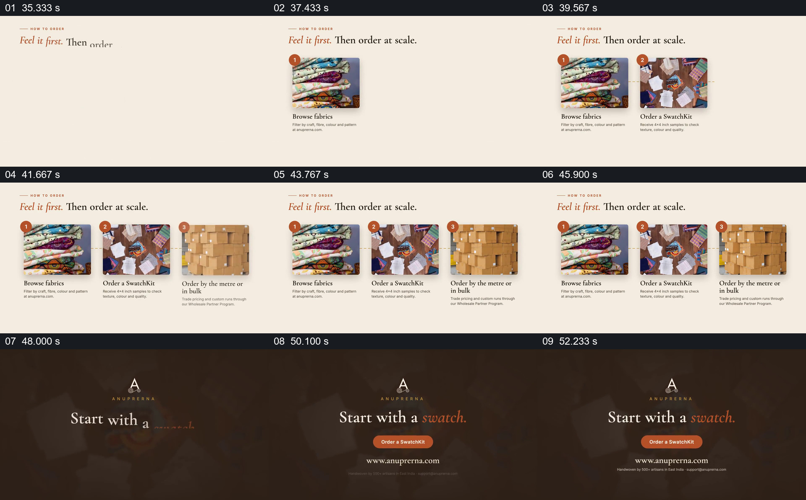

# 先看布料、再取样、最后批量订购

- 作品：案例 014《织物照片与品牌叙事》（索引名称）。
- 原片范围：00:35.000–00:54.000，含起点、不含终点；[完整原片](../video.mp4)｜[本卡片段](c04.mp4)。
- 观察方式：依据整片 64 宫格和约每秒一次的真实源帧观察，未连续原速观看；媒体探测显示原片没有音轨，因此没有可听审的原声。

## 原画面具体怎样设计

标题“Feel it first. Then order at scale.”下，三张编号图片从左到右依次建立：布料堆、样品组合、包装箱，配有浏览、订样及按米或批量订购的说明。三步同时停留，之后切回深棕色品牌页，出现“Start with a swatch.”和按钮。

## 为什么这样设计，好在哪里

每一步用一张不同职责的图片承接，后一步出现时保留前一步，观众能看到先后关系和最终去向。结尾把行动落回中间的样品环节，使抽象采购过程有具体起点。

以上为依据画面的分析，非作者自述；预期观看效果未经观众测试。

## 可直接使用的创意指令

当展示分步采购或体验流程时，先核实每一步的真实顺序、进入条件与结果，为各步骤选一张可辨的材料图，按步骤逐项加入并保留已出现的内容；最后把行动提示指向实际可执行的第一步或关键决策点。标注价格、门槛或条件需要时，与当前政策核对，按钮样式不代表真实功能。
