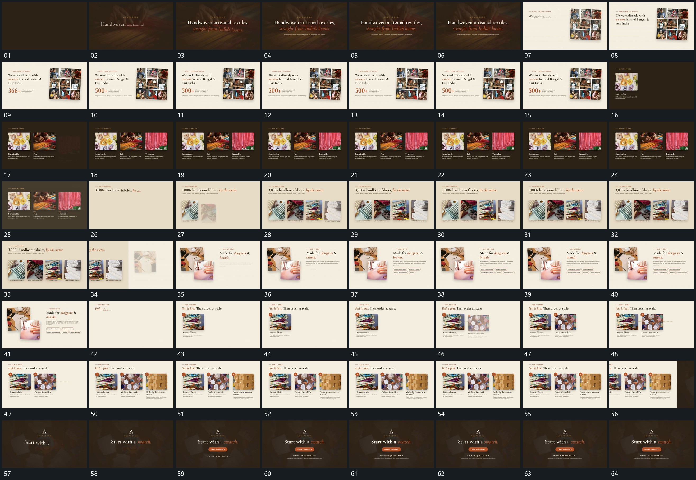

# 014｜原片运动总览

[观看完整原片](video.mp4)

## 运动总览

开头 后层缓慢移动，前方字组逐行显出 在缓慢活动的后层上逐行显出文字，换底后右侧网格留场，旁字与数字接续建立。随后 图块按左右空位逐项建立，配套字随后接入 从左到右补齐三组图块和各自下方文字；同样关系在后面的四片横排与三步图块中复用。

中间 新布局从侧边推进，旧组沿边退去 让新布局从侧面接管，旧组离开；两片前后错开建立，旁侧文字与标签累积 在新布局里建立前后交叠的两片，再补旁侧文字和短标签。之后回到逐项横排，末段以 后层缓慢移动，前方字组逐行显出 建立中心短句与下方长条，完整保持后结束。

## 完整运动段落

以下按原片中的出现顺序引用。建立、内部发展及完成反馈放在同一段中；同时发生的局部动作与运镜写在同一份指令里。不同段之间可以是连续接管，也可以是直接切换，不能仅凭条目相邻认定可直接拼接。重复出现的同类运动采用一次连续代表范围，切片不以逐段无缝覆盖整片为目标。

1. [后层缓慢移动，前方字组逐行显出](mechanisms/m01.md)：文字固定建立，后层继续小幅运动

2. [图块按左右空位逐项建立，配套字随后接入](mechanisms/m02.md)：一项先完整，下一项再补入，先到者保持

3. [侧向接入新布局，前后两片与旁字接力建立](mechanisms/m05.md)：侧向接管是新布局的进入，随后两片错开落位、旁字与标签累积，共同完成建立。

切片保留起始准备、必要内部停顿和完成或明确交接；首尾省略无新发展的等待，持续运动不要求人为停住。以上基于真实源帧序列和重点边界核对，不等同于全片连续声画审片。

## 完整64宫格

