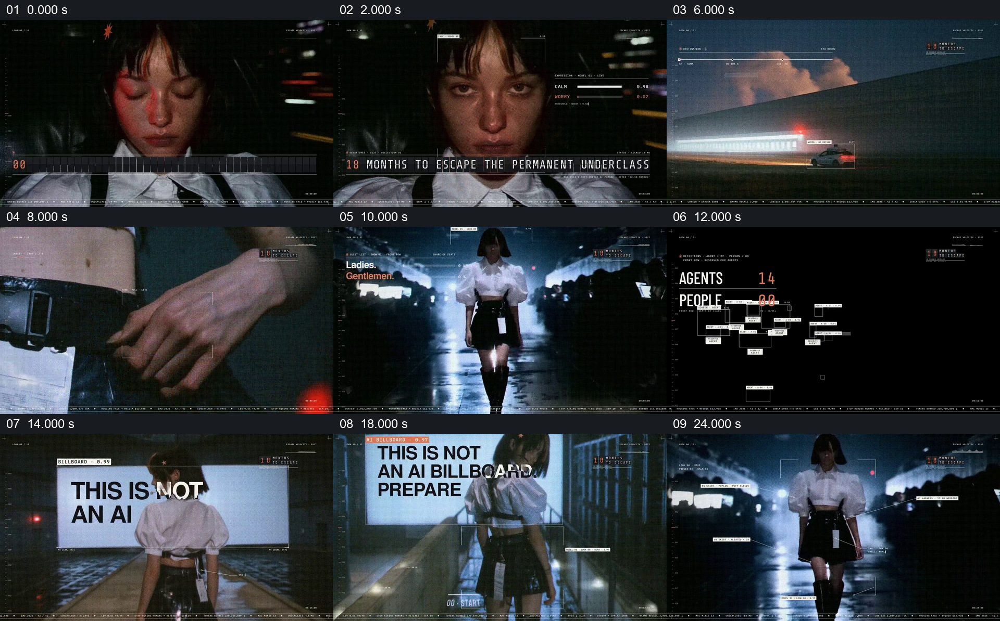

# 从人物被识别到秀场被监控，建立虚构世界

- 作品：案例 004《人物影像、服饰与图形标注》，为原库索引名称。
- 原片范围：00:00.000–00:26.000，含起点、不含终点；[完整原片](../video.mp4)｜[本卡片段](c01.mp4)。
- 范围依据：从人物近景及倒计时建立，到秀场人物与服饰标注形成开场完整画面；后续开始编号造型展示。 范围与已有创意切片一致，复用既有切片和分镜。
- 观察方式与未确认范围：查看原片 64 帧总览和本卡九宫格；对原先未建卡的 74–98、164–184、250–275 秒补看逐秒源帧。未独立连续原速观看或听审，抽帧间动作、准确速度和声音配合仍待复核。画面中的数字、判断和界面均是作品呈现，设计价值为分析而非作者自述。

## 原画面具体怎样设计

画面一开始是深暗背景中的人物脸部近景，人物闭眼、睁眼；面部附近出现识别框和情绪条，底部横条显出“18 MONTHS TO ESCAPE THE PERMANENT UNDERCLASS”。这些界面位于人物周围，人物仍是观看中心，右上角的小倒计时此后反复出现。

随后出现远处建筑、夜间车辆和人物手部及服饰特写；检测框分别落在车辆、手和配件上。画面再到湿亮地面的夜间秀场，人物穿白衬衫和黑裙居中走来，两边观众作为暗色轮廓，后方强光和地面反射形成纵深。

秀场之间穿插黑底的 AGENTS／PEOPLE 计数与白色广告牌；人物背对观众站在牌前，广告牌上写着“THIS IS NOT AN AI BILLBOARD”，画中却以界面标签标出 AI BILLBOARD。回到全身秀场后，衣领、肩袖、背带和裙装得到指线标注。开场最后仍以人物在同一场地的身影作为后续造型的参照。

## 为什么这样设计，好在哪里

开场先给出一张可辨认的脸，再把同一人放到车辆、广告牌与秀场中，使监测信息始终有具体对象；远景的场地和近景的手部则交代这个世界既有空间，也有可接触的服饰。

广告牌自称“不是 AI”，检测标签却写着相反的分类，视觉上的说法与界面判断并置形成讽刺；持续出现的小倒计时则把不同空间连接到同一威胁设定。若只保留酷炫检测框，缺少人物、场景和相反文字，画面会退化成无对象的信息装饰。这是对作品的分析，不表示识别界面或其数字真实。

## 可直接使用的创意指令

为需要建立虚构设定的内容准备一个可持续辨认的主体、能够表现其处境的环境和一项贯穿性的规则或提示。先让主体以可识别的近景出现，再把同一主体带到与故事有关的较大空间；只在对象附近设置有具体含义的标记，让标签指向脸、动作或环境中的真实可见对象。

用一个反复出现但不抢夺主体的提示连接后续镜头；如果内容需要反讽，可让画中公开说法和虚构系统判断形成明确矛盾。人物、场景、色彩与界面样式均可变化，必须保留主体、环境及提示之间可理解的关系。纪实内容要标明模拟界面，不能把虚构检测结果当真实证据。

新题材中的迁移效果尚未实测。
