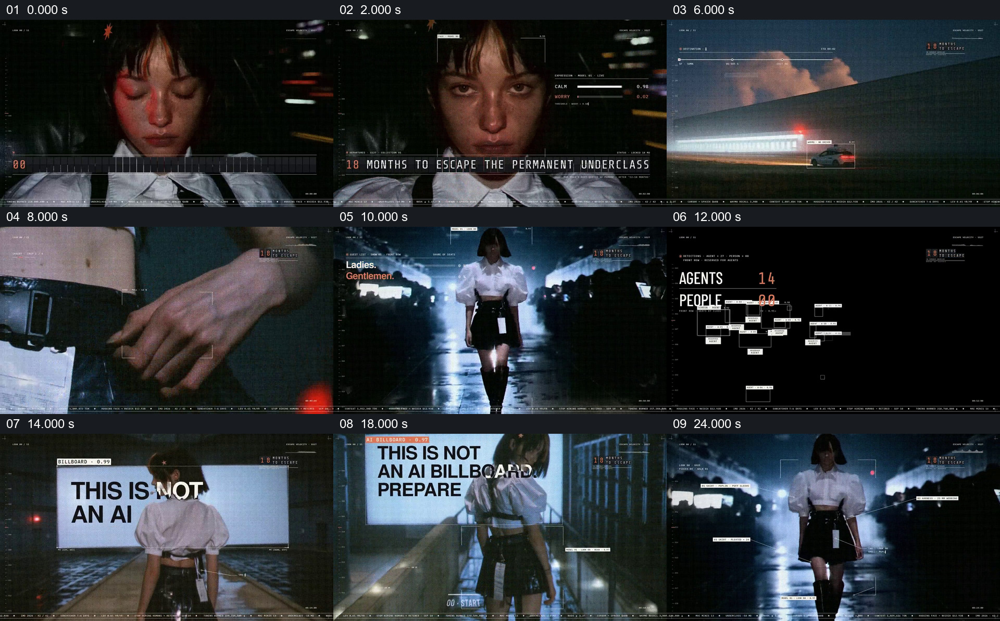

# 从人物被识别到秀场被监控，建立虚构世界

- 作品：案例 004《人物影像、服饰与图形标注》，为原库索引名称。
- 原片范围：00:00.000–00:26.000，含起点、不含终点；[完整原片](../video.mp4)｜[本卡片段](c01.mp4)。
- 范围依据：从人物近景及倒计时建立，到秀场人物与服饰标注形成开场完整画面；后续开始编号造型展示。 范围与已有创意切片一致，复用既有切片和分镜。
- 观察方式与未确认范围：查看原片 64 帧总览和本卡九宫格；对原先未建卡的 74–98、164–184、250–275 秒补看逐秒源帧。未独立连续原速观看或听审，抽帧间动作、准确速度和声音配合仍待复核。画面中的数字、判断和界面均是作品呈现，设计价值为分析而非作者自述。

## 原画面具体怎样设计

画面一开始是深暗背景中的人物脸部近景，人物闭眼、睁眼；面部附近出现识别框和情绪条，底部横条显出“18 MONTHS TO ESCAPE THE PERMANENT UNDERCLASS”。这些界面位于人物周围，人物仍是观看中心，右上角的小倒计时此后反复出现。

随后出现远处建筑、夜间车辆和人物手部及服饰特写；检测框分别落在车辆、手和配件上。画面再到湿亮地面的夜间秀场，人物穿白衬衫和黑裙居中走来，两边观众作为暗色轮廓，后方强光和地面反射形成纵深。

秀场之间穿插黑底的 AGENTS／PEOPLE 计数与白色广告牌；人物背对观众站在牌前，广告牌上写着“THIS IS NOT AN AI BILLBOARD”，画中却以界面标签标出 AI BILLBOARD。回到全身秀场后，衣领、肩袖、背带和裙装得到指线标注。开场最后仍以人物在同一场地的身影作为后续造型的参照。

## 为什么这样设计，好在哪里

开场先给出一张可辨认的脸，再把同一人放到车辆、广告牌与秀场中，使监测信息始终有具体对象；远景的场地和近景的手部则交代这个世界既有空间，也有可接触的服饰。

广告牌自称“不是 AI”，检测标签却写着相反的分类，视觉上的说法与界面判断并置形成讽刺；持续出现的小倒计时则把不同空间连接到同一威胁设定。若只保留酷炫检测框，缺少人物、场景和相反文字，画面会退化成无对象的信息装饰。这是对作品的分析，不表示识别界面或其数字真实。

## 完整照排指令

以[完整原片](../video.mp4)的 0–26 秒为准。画幅 1280×720，源帧率 24/1。以下拍点为抽帧定位，位置按画幅百分比取近似值。

### 用料

- 【主角特写】【跑道正面】【跑道背面】【场馆侧视】须让同一位表演者的发型、白上衣与黑色背带轮廓贯穿。跑道正反向镜头须同一场地或能对齐的狭长轴线，两侧有暗观众、远端冷白面光，地面能接住反光。另备同一造型上的【服装条码近景】。
- 【道路远景】【车辆侧视】取同一出发过程的两种视点。道路须有沿深度方向延伸的灯迹，侧视有地平线、低位车辆和背后的长光带。可虚构车辆或场景，保留两视点的事件关联。
- 【追踪字幕】【识别票标题】【识别票字段】【计数对象甲】【计数对象乙】【计数甲】【计数乙】【开场对白】【背屏宣言】【造型序号】【现场告示标题】【现场告示字段】均用新片剧本的文字和数。识别票、条码、扫描数字及界面读数是片中世界的道具。如采用真实地点、机构数据或人物身份，附可打开的对应来源。票上的栏目保持多行短字段，宣言压缩为三行内。

### 按源时刻摆放

1. **0.000–约 2.000 秒。** 近黑环境中【主角特写】正脸置于 x28%–65%，红光擦过半边脸。底部约 y78% 横铺窄黑半透明【追踪字幕】带，用小号高反差白等宽字，先见杂乱字符再读成一句。扫描细角标贴脸外，画缘及顶角留微弱读数；近 1 秒眼睛看向观察者。角标应追随头位，底部字幕留在屏幕坐标。
2. **约 2.000–8.000 秒。** 硬切【道路远景】，细线网格从下方扩到远处，两条主要红光向远端汇合，小框分布在纵深上。字幕带继续占原高度。约 4 秒返回【主角特写】，脸朝右侧，右上叠奶白【识别票标题】与【识别票字段】，标题黑粗、分组字段小而密、底边独立细条码。约 6 秒改【车辆侧视】，大块黑墙切斜线，车落在下三分之一的亮带前，红点和细框贴车移动。用实拍连续段承接这些跟踪，禁止用静图运镜替代车辆轨迹。
3. **约 8.000–11.800 秒。** 切【服装条码近景】，银黑褶皱占满底，竖白标签带黑码在中心偏右，监控细框作为透明层压在衣料外。约 9 秒转【跑道正面】，人物走在中轴冷光反射上，两侧观众保留黑块。左面先放短白【开场对白】，再落字号更大的白主词与细红横线。约 11 秒进近黑界面，两行【计数对象甲】【计数对象乙】左齐，两栏【计数甲】【计数乙】右对齐，后行用红划或红色变化。整帧黑一拍用来断开实拍。
4. **约 12.000–16.000 秒。** 用【跑道背面】重新从中轴拉开纵深。大横屏横跨上半部，先白底空出，再以粗黑无衬线逐行写【背屏宣言】，始终贴在实际屏面上并受人物头肩遮挡。约 15 秒切【主角特写】的偏身动作，左下黑小信息框先建立；保留红信号和冷蓝背景点光。
5. **约 16.000–20.000 秒。** 回到背面走位，屏上【背屏宣言】仍是同一句，并补足末行。约 18 秒切正面；左下【造型序号】改白色细斜衬线，人物前进时不跟着偏。冷光主轴、地面水亮和离散的两侧观众仍是同一个空间。
6. **约 20.000–26.000 秒。** 【场馆侧视】占满，亮条向远处斜去，观众局部压在下半，右侧留奶白【现场告示标题】及【现场告示字段】，保持粗标题、小字段与底部条码。约 22 秒回跑道正面，约 23 秒转主角近景，让冷点光和扫描框陪同脸部进入下一组造型的开篇。26.000 秒按索引切出；下一卡如使用紧邻源段，直接用相同主体和色光承接。

### 局部采用

只有识别环境和人物特写时，可用 0.000–约 6.000 秒。只有可对齐的秀场镜头时，可用约 12.000–20.000 秒，从背屏建字到跑道正面。正面、背面和近景需能认出同一个人，切换后不可重新起同一步。窗内无多屏持续播放要求，告示文字和姓名票为静态前景。

### 验证状态

已对照该段原片 1 帧/秒画序并读回。核对了识别字幕跨道路保留、左侧对白到黑底计数、背屏文字与人物的叠压、冷光跑道回切。精确动作边界、原速和听审待补看，暂无换料试摆。
