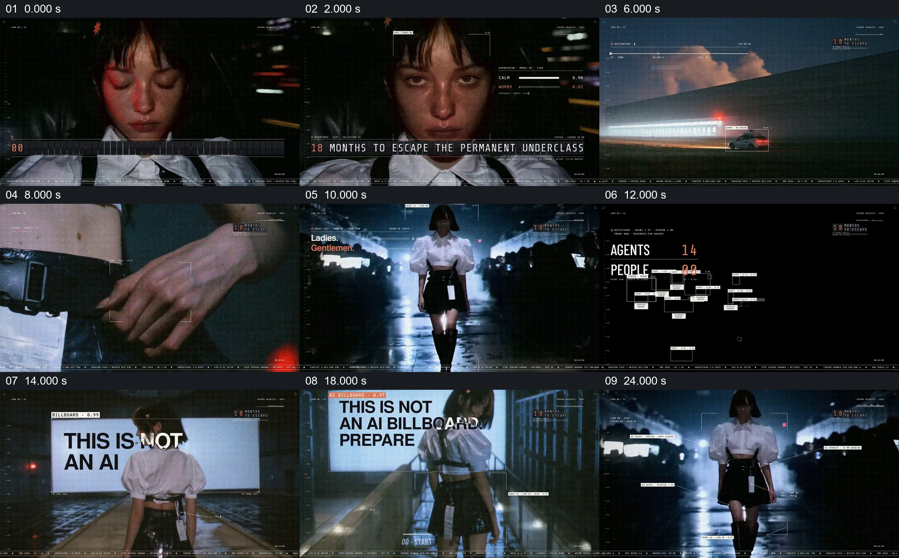

# 用人物、秀场和虚构监控界面建立世界

- 作品：案例 004《人物影像、服饰与图形标注》（索引名称）。
- 原片范围：00:00.000–00:26.000，含起点、不含终点；[完整原片](../video.mp4)｜[本卡完整片段](c01.mp4)。
- 观察方式：按整片 64 宫格和每两秒一个原片帧观察全片，并选取下方九个源帧；未连续原速观看或听审，快速切换、声音与语气保持未知。

## 原画面具体怎样设计

人物先在暗处闭眼、抬眼，脸旁出现表情状态条，底部字符落成“18 MONTHS TO ESCAPE THE PERMANENT UNDERCLASS”。随后画面切到夜间建筑、车和衣服扣具，人物走上有观众的湿地秀场，旁边叠加人员检测和界面。人物背对镜头面对巨幅白色广告板，板上逐步出现“THIS IS NOT AN AI BILLBOARD”等文字；人物近景与秀场再交替，观众手机、服装和 Look 00 标签出现。

## 为什么这样设计，好在哪里

相同人物和服饰把不同尺度的镜头串起来；检测框、倒计时与广告板把造型展示组织成一个带规则的虚构世界。观众先看到人物和环境，再看到场中的标语和注释。这些读数与标语是作品画面，不能当作真实监测、时间预测或现实事件证据。 这是基于画面的作品分析，不代表作者自述或已测量的观众反应。

## 可直接使用的创意指令

当作品需要建立虚构世界及其中的主角时，先准备能互相识别的角色近景、身体或服饰细节和环境镜头；依照内容选一两条规则或问题，让它们以场内标语或明确设计的界面注释出现。让角色在环境中行动，叠加层遵循同一世界的观察逻辑，保持主体清楚可辨，再以完整场面交接后续情节。真实人物、场所和数据须另有依据，虚构监控与预测要与事实材料区分。
