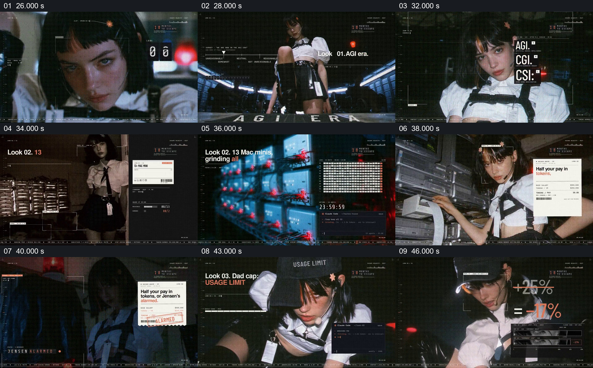

# 用一组服饰造型和价签式界面串起技术讽刺

- 作品：案例 004《人物影像、服饰与图形标注》（索引名称）。
- 原片范围：00:26.000–00:47.000，含起点、不含终点；[完整原片](../video.mp4)｜[本卡完整片段](c02.mp4)。
- 观察方式：按整片 64 宫格和每两秒一个原片帧观察全片，并选取下方九个源帧；未连续原速观看或听审，快速切换、声音与语气保持未知。

## 原画面具体怎样设计

人物特写接到 Look 01 的秀场造型，AGI、CGI、CSI 等短词在人物旁逐项出现。Look 02 先显示人物与设备，又切到多台发光设备及密集小格，人物站在设备旁时浮出写有“Half your pay in tokens”的票据式卡片，随后追加警报文字。Look 03 换成帽子造型，画面写有“USAGE LIMIT REACHED”，并出现被划去的百分比及新数字，人物持续占据主要区域。

## 为什么这样设计，好在哪里

编号、同一人物和相似的标签排版使这些例子被读成一组造型；每一套又用设备、票据或帽子动作对应一句短话，把技术话题转成可观看的物件关系。百分比、工资和设备数量只是片中讽刺表达，不能据此证明现实情况。 这是基于画面的作品分析，不代表作者自述或已测量的观众反应。

## 可直接使用的创意指令

当需要用一系列对象承载多个相关观点时，先设定贯穿全组的主体与目录规则，例如人物、编号和统一的标签位置；为每个观点选择具体可见的对象或动作，让文字与对象发生直接关系。按识别当前项、展示物件、显露对应短句的需要推进，并让前后项有清楚交接。讽刺或虚构的票据、计数应与真实资料区分；现实人物和数字以来源及授权为准。
