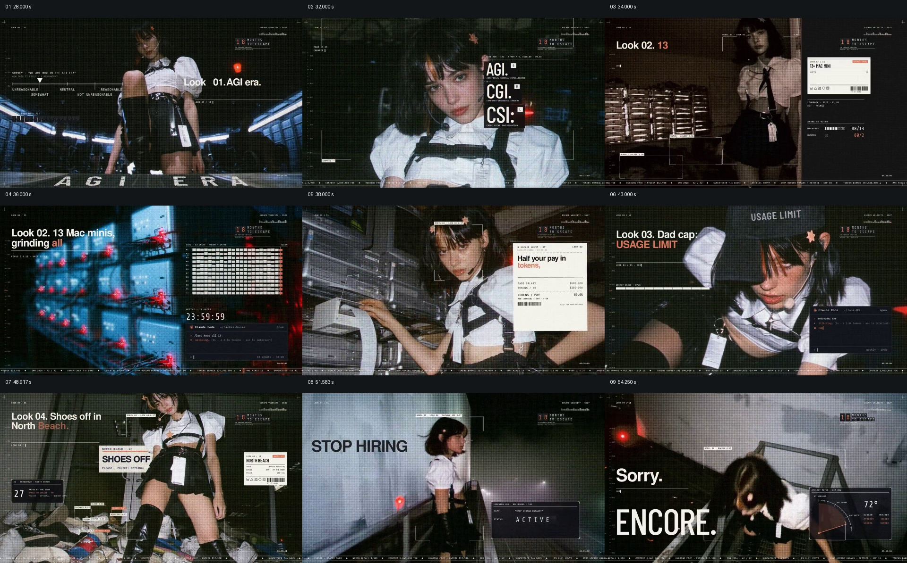

# 让一组造型成为一组科技寓言

- 作品：案例 004《人物影像、服饰与图形标注》，为原库索引名称。
- 原片范围：00:26.000–00:55.000，含起点、不含终点；[完整原片](../video.mp4)｜[本卡片段](c02-20261111.mp4)。
- 范围依据：将原先 26–47 秒与 47–55 秒两段合并：Look 01–04 连续使用同一人物、编号和价签，构成一组系列展示；55 秒转入乘车情节。 新范围从完整原片生成新切片和分镜。
- 观察方式与未确认范围：查看原片 64 帧总览和本卡九宫格；对原先未建卡的 74–98、164–184、250–275 秒补看逐秒源帧。未独立连续原速观看或听审，抽帧间动作、准确速度和声音配合仍待复核。画面中的数字、判断和界面均是作品呈现，设计价值为分析而非作者自述。

## 原画面具体怎样设计

26 秒附近先是人物脸部近景，随后低角度全身及“Look 01”文字建立第一套造型；人物的白色泡袖、黑色背带和短裙持续可辨。旁边列出的 AGI、CGI、CSI 等缩写与人物并排，技术词成为造型说明的一部分。

Look 02 把人物带到成排设备旁：一侧有标签与条形码，另一侧是设备阵列和工作计数；人物手拿纸条时，工资票据显示“Half your pay in tokens”，之后印章覆盖票据。Look 03 转为帽子近景，“USAGE LIMIT”同时出现在帽子与大字中，右侧百分比和条形图继续补充限额主题。

Look 04 在堆满鞋的地面上显示人物全身，旁边出现“SHOES OFF”牌、标签及大额数字；接着人物与墙上“STOP HIRING”同框，橙色“RETIRED”覆盖字样，最后通过人物弯腰、画内“ENCORE”结束这一组。每套在主体、道具和信息侧重上改变，但共同保留人物、编号、服饰标签及深色虚构界面。

## 为什么这样设计，好在哪里

编号和价签提供固定阅读方式，使观众知道这些片段属于同一场时装系列；每款却用不同的真实可见道具承接观点：设备配工资票据，帽子承接限额，鞋堆接“SHOES OFF”。说明文字不是独立页面，而与人物身体、道具和环境共同构成每套造型。

如果把四套分别拆成只有单个标签的卡，容易失去“同一人物反复进入不同技术处境”的系列关系；反过来只列出四个抽象关键词，也看不到观点如何借实物出现。片中金额、统计和品牌指称均属于作品中的表现，不能直接视为真实事实。

## 完整照排指令

以[完整原片](../video.mp4)的 26–55 秒为准。画幅 1280×720，源帧率 24/1。以下拍点为抽帧定位，位置按画幅百分比取近似值。

### 用料

- 【共同造型】同一表演者及可跨镜识别的黑白衣着，保留胸前一处可挂长签的位置。准备【造型一影像】【造型二影像】【造型三影像】【造型四影像】，每组至少有能看清人和物关系的中景及道具特写。走位、手持和弯腰使用连续表演。
- 【造型名一】【造型名二】【造型名三】【造型名四】用一至两行短标题，保留连续编号，重点词可用暖橙。【服饰标签】为竖白纸与黑印字、细码，多个镜头都挂在同一位置，转身时随衣物改变角度。
- 【术语短列】三至四行、每行一个短词。【设备阵列】【设备计数】对应同一工作环境及运转时钟。【工资票标题】【工资票字段】【票上印章】对应同一张票上的工资条件与章印。
- 【帽上限额字样】【限额提示】【百分比甲】【百分比乙】【限额曲线】围绕相同的使用限制。【地面道具堆】【道具告示】【金额主数】【金额注记】【墙面标语】【覆盖章】【谢幕词】依次对应实物堆、场上标牌、显著金额、墙上字及人物最后动作。虚构用料作为剧情道具，若引用真实金额、限额、工资或设备计数，逐项提供可打开的出处、日期和口径。

### 按源时刻摆放

1. **26.000–约 32.000 秒，第一套。** 从前段同人物的黑白近景接入。【造型一影像】在人行轴线中间，白泡袖托亮上半部，黑短裙与下挂【服饰标签】把身体分出层次。左面贴奶白资料票，右上出现白字【造型名一】。短切低角度，保留后方斜冷光和脚边大字的透视。约 29 秒至 32 秒用脸与胸肩近景，让【术语短列】在人物右边逐行累积，白字为主，当前强调行转橙。镜头内部保留人物姿态，不让技术字覆盖双眼。
2. **约 32.000–39.000 秒，第二套。** 【造型二影像】让人站在暗设备列边，左上以白色短标题【造型名二】建位。先让人物和暖色横列设备同场，再切冷蓝多排【设备阵列】，右侧暗界面放密集格点与浅色等宽【设备计数】，红点留在设备上。设备屏幕可连续播放，时钟和阵列从约 34 秒的插镜建立到约 36 秒回到人物前，需足够真实运动或独立绘制状态变化。切回人物手碰设备，右侧立奶白票页，黑粗【工资票标题】逐行出现，下面有分组小字【工资票字段】和条码。最后才叠【票上印章】，先让未经盖章的句子可读。保持人物和票同屏，票为静态叠加。
3. **约 39.000–46.000 秒，第三套。** 【造型三影像】用俯拍靠近戴帽的人，暗底的大号轮廓数及细线压低反差，左上用小号白【造型名三】。再切压帽檐的脸部，帽面保留实物【帽上限额字样】，左侧叠橙色大号【限额提示】并加细横线。右下浮暗色界面，先有短条，逐步出现【限额曲线】。右上粗白【百分比甲】先独占，末拍再出现与之相减或比较的【百分比乙】，运算符或划线按口径填写。画面始终以帽与视线为中心，大数靠右并避脸。
4. **约 46.000–51.000 秒，第四套建立。** 【造型四影像】在散落【地面道具堆】的地面站立，白衣黑裙沿中轴竖起，左侧【道具告示】用奶白底黑字横过道具上方，右侧补小票。随后切人脸，左上【造型名四】保留两行分量，右侧跳出白色粗大【金额主数】及极小【金额注记】。单独切悬挂【服饰标签】特写时保持方向，数字仍在右边原位。这两个近景应紧接同一造型，不使用另一人的标签补画。
5. **约 51.000–55.000 秒，第四套退出。** 换冷灰墙和狭窄过道，【墙面标语】为左侧粗黑大字，和人物组成左右两块。橙色【覆盖章】压在墙字的投影范围内；人物经过仍遮住背景。再切中景和弯身动作，左侧先出现小白短语，随后更大白色【谢幕词】。约 55 秒白色车辆画面开下一段，以 55.000 秒为切出边界。人物弯身与遮挡使用连续动作，保留走秀语境，不靠照片放大补替。

### 局部采用

单套用料齐全时可从该套编号出现处用到下一套接管。第一套约 26–32 秒，第二套约 32–39 秒，第三套约 39–46 秒，第四套约 46–55 秒。第四套只有鞋堆与金额素材时，可用约 46–51 秒，结束于标签特写。各套的编号在孤立使用时可按新片改写。

### 验证状态

已对照 26–55 秒的原片逐秒画序及原卡分镜，重点核对词列累积、票先成形后盖章、帽字与叠字各在其层、金额跨人物和标签近景保留。快速切换的精确帧、原速听看和换料试摆待核。
