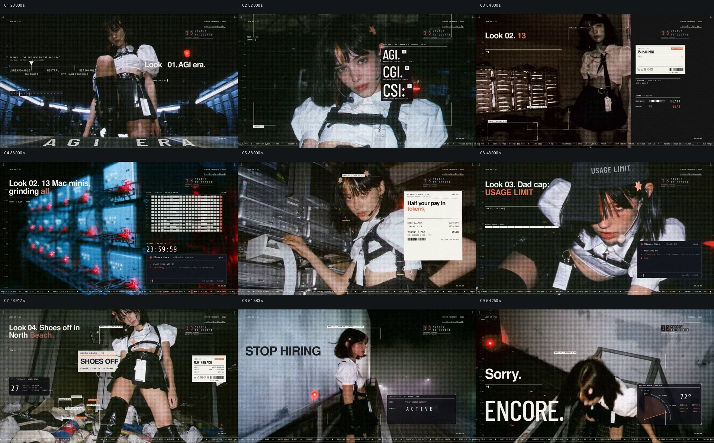

# 让一组造型成为一组科技寓言

- 作品：案例 004《人物影像、服饰与图形标注》，为原库索引名称。
- 原片范围：00:26.000–00:55.000，含起点、不含终点；[完整原片](../video.mp4)｜[本卡片段](c02-20261111.mp4)。
- 范围依据：将原先 26–47 秒与 47–55 秒两段合并：Look 01–04 连续使用同一人物、编号和价签，构成一组系列展示；55 秒转入乘车情节。 新范围从完整原片生成新切片和分镜。
- 观察方式与未确认范围：查看原片 64 帧总览和本卡九宫格；对原先未建卡的 74–98、164–184、250–275 秒补看逐秒源帧。未独立连续原速观看或听审，抽帧间动作、准确速度和声音配合仍待复核。画面中的数字、判断和界面均是作品呈现，设计价值为分析而非作者自述。

## 原画面具体怎样设计

26 秒附近先是人物脸部近景，随后低角度全身及“Look 01”文字建立第一套造型；人物的白色泡袖、黑色背带和短裙持续可辨。旁边列出的 AGI、CGI、CSI 等缩写与人物并排，技术词成为造型说明的一部分。

Look 02 把人物带到成排设备旁：一侧有标签与条形码，另一侧是设备阵列和工作计数；人物手拿纸条时，工资票据显示“Half your pay in tokens”，之后印章覆盖票据。Look 03 转为帽子近景，“USAGE LIMIT”同时出现在帽子与大字中，右侧百分比和条形图继续补充限额主题。

Look 04 在堆满鞋的地面上显示人物全身，旁边出现“SHOES OFF”牌、标签及大额数字；接着人物与墙上“STOP HIRING”同框，橙色“RETIRED”覆盖字样，最后通过人物弯腰、画内“ENCORE”结束这一组。每套在主体、道具和信息侧重上改变，但共同保留人物、编号、服饰标签及深色虚构界面。

## 为什么这样设计，好在哪里

编号和价签提供固定阅读方式，使观众知道这些片段属于同一场时装系列；每款却用不同的真实可见道具承接观点：设备配工资票据，帽子承接限额，鞋堆接“SHOES OFF”。说明文字不是独立页面，而与人物身体、道具和环境共同构成每套造型。

如果把四套分别拆成只有单个标签的卡，容易失去“同一人物反复进入不同技术处境”的系列关系；反过来只列出四个抽象关键词，也看不到观点如何借实物出现。片中金额、统计和品牌指称均属于作品中的表现，不能直接视为真实事实。

## 可直接使用的创意指令

当多个观点属于同一主题且各自有可表现的物件时，先确定同一人物或物件作为跨场景的共同参照，再为每一项准备能看出差别的场地、动作或服饰。使用重复的编号、标签或版面位置建立系列身份，让每个观点在对应物件旁显露，并在必要处切到细节以便读懂文字。

各款不必使用相同道具、数量或颜色，但要保留可识别主体、每款特有的对象关系和系列之间的共同标识。需要事实依据的数字应取得来源；没有多个具体观点和材料时，不必勉强制作编号清单。

新题材中的迁移效果尚未实测。
