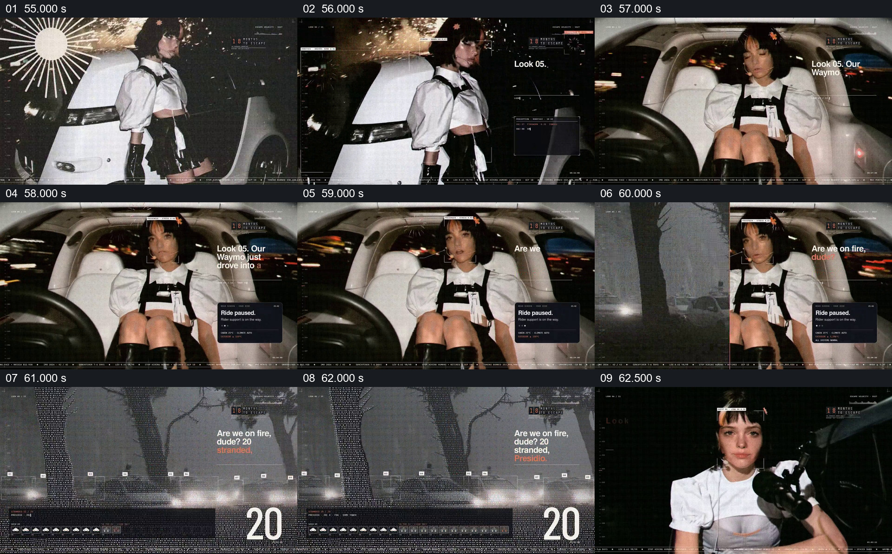

# 让乘车中断同时出现在人物处境和界面状态里

- 作品：案例 004《人物影像、服饰与图形标注》，为原库索引名称。
- 原片范围：00:55.000–01:03.000，含起点、不含终点；[完整原片](../video.mp4)｜[本卡片段](c03.mp4)。
- 范围依据：从车外人物及车辆建立，到车内暂停状态和外部车辆环境显露；之后切入另一项麦克风演出。 范围与已有创意切片一致，复用既有切片和分镜。
- 观察方式与未确认范围：查看原片 64 帧总览和本卡九宫格；对原先未建卡的 74–98、164–184、250–275 秒补看逐秒源帧。未独立连续原速观看或听审，抽帧间动作、准确速度和声音配合仍待复核。画面中的数字、判断和界面均是作品呈现，设计价值为分析而非作者自述。

## 原画面具体怎样设计

画面先以夜间白色车辆和站在车旁的同一人物建立乘车环境，人物与车辆共同入画，右上仍保留小倒计时。随后视角转到车内，人物坐在白色座椅中央，前景可见方向盘，背景透过车窗显露夜间灯光。

右下出现深色卡片“Ride paused. Rider support is on the way”，右上文字逐步增加，车内人物仍保持主要面积；后续画面切到灰暗树林与多辆车，叠加连续车辆框及“20”数字。片段末尾进入另一场人物与麦克风的近景。

## 为什么这样设计，好在哪里

外部车辆、车内乘客与状态卡按顺序建立“谁在哪里、遇到了什么”，而不是只给一张报错界面。车内画面的空间参照仍然清楚时，暂停提示才有具体处境；外部车辆画面又将个体经历扩展到一组被困车辆的片中描绘。

画面中的车辆品牌、数量和事故细节是作品的虚构或演示表达，本次没有核实其真实性；静帧不足以确认车辆是否真的连续移动。

## 完整照排指令

以[完整原片](../video.mp4)的 55–63 秒为准。画幅 1280×720，源帧率 24/1。以下拍点为抽帧定位，位置按画幅百分比取近似值。

### 用料

- 【车外镜头】【车内镜头】为同一人物、同一车辆或明确可匹配的车型。车外保留白色车身与低照度光带，车内需要侧移的街灯、可见方向盘及人物可辨的服装和手势。另备【故障观察窗】的灰噪街景，以及可接下段的【结束近景】。
- 【造型开场】【造型说明】【故障标题】【故障字段】【人物短句】【受影响数量】【下一造型标题】按虚构事件或实际事件正确填写。故障窗内数值与画内短句共用同一事件口径。若声称真实车辆故障或受影响人数，附可复核记录、时间、地点与统计口径。

### 按源时刻摆放

1. **55.000–约 57.000 秒。** 【车外镜头】满铺。白车大斜面横在画面下半，中部站黑白衣的主角，上方左边是红白亮光，末端散入近黑。画边压细监控线及小字，右上小白【造型开场】逐步展开为【造型说明】，一行字号近似、重点词偏橙。字组留在右侧空暗区。
2. **约 57.000–60.000 秒。** 硬切同一人的【车内镜头】。黑方向盘占左下大弧，白座椅环绕中间偏右的人物，窗外光带横移。保留角部细线，右上行文续到【人物短句】；右下叠近黑小矩形，白粗小字【故障标题】，下面更小灰白【故障字段】和细分隔。人物动作自进车镜开始贯穿至故障观察窗接管，禁止用冻结或循环伪造停车过程。状态板稳定时窗外和人物仍有动作。
3. **约 60.000–62.000 秒。** 切【故障观察窗】，全屏灰噪，立面与路面只留隐约明暗。小白【人物短句】仍在右上，逐步补充；主画面下缘加薄监看线。右下将【受影响数量】从暖橙矩形内的黑字移为无底的粗白大字，左下进细长暗进度条。用实际观察画面或明确的剧情示意，2 秒内保留噪波活动。
4. **约 62.000–63.000 秒。** 故障观察窗让位给【结束近景】，人物白上衣居中偏左，右侧黑道具切入胸肩前，保留四角暗框。右侧用一至两行白小字【下一造型标题】开新拍。63.000 秒按索引切出，若后段不采用，可在故障窗完毕时结束。

### 局部采用

只有一组可关联车内镜头和可信状态时，可用约 57.000–60.000 秒，从车内切入，在灰故障窗出现前切出。若要表现事故冲击或数量，须有 60.000 秒后观察窗与对应依据。

### 验证状态

已对照该段原片 1 帧/秒画序并读回。核对车外白车与车内白座呼应、故障板压在仍活动的车内景上，以及橙底黑数到灰窗白数的变化。快速状态切点、原速和听审待核，暂无换料试摆。
