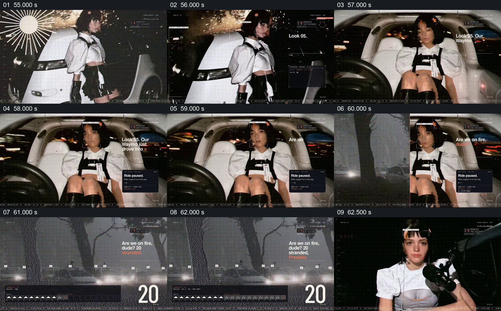

# 把乘车中断写成角色处境与状态面板

- 作品：案例 004《人物影像、服饰与图形标注》（索引名称）。
- 原片范围：00:55.000–01:03.000，含起点、不含终点；[完整原片](../video.mp4)｜[本卡完整片段](c03.mp4)。
- 观察方式：按整片 64 宫格和每两秒一个原片帧观察全片，并选取下方九个源帧；未连续原速观看或听审，快速切换、声音与语气保持未知。

## 原画面具体怎样设计

人物先出现在车辆外侧，接着坐进白色车厢；旁边出现“Ride paused”状态卡，角色周围有追踪框。画面逐渐补出关于车辆处境的短句；之后切到灰色环境与数字、图形注释，延续停驶状态，再交给下一造型。

## 为什么这样设计，好在哪里

先让观众看到人已处于车里，再显示暂停状态，系统问题就被放在可见的人物处境中；环境与界面提供后续观察方向。已观察画面没有提供可核实的事件来源，车辆事故和人数只能视为片中演示内容。 这是基于画面的作品分析，不代表作者自述或已测量的观众反应。

## 可直接使用的创意指令

当真实事件或明确虚构的情节涉及系统中断时，先交代人物和系统的关系，再显示可读的状态提示。选择能说明后续处境的环境、行动或经核实的反馈与其接续；保持人物、状态和时间关系，不把装饰数字做成事实。真实事件需使用对应来源与准确素材，虚构演示应明确其性质。
