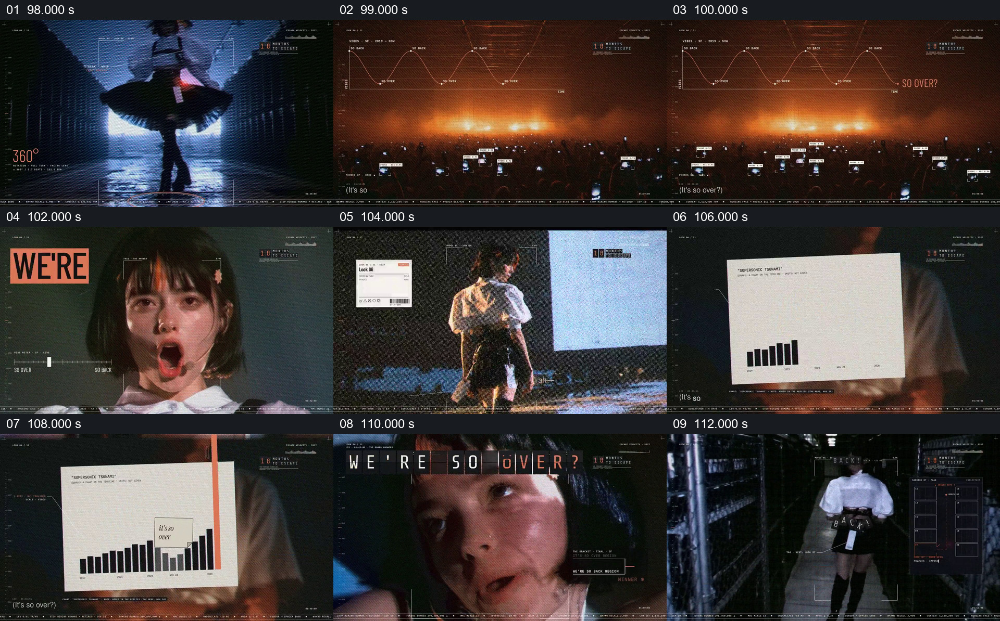

# 在人物演出与图表之间反复摆出相反判断

- 作品：案例 004《人物影像、服饰与图形标注》（索引名称）。
- 原片范围：01:38.000–01:53.000，含起点、不含终点；[完整原片](../video.mp4)｜[本卡完整片段](c04.mp4)。
- 观察方式：按整片 64 宫格和每两秒一个原片帧观察全片，并选取下方九个源帧；未连续原速观看或听审，快速切换、声音与语气保持未知。

## 原画面具体怎样设计

人物在蓝色光下旋转，画面切到观众与图形曲线，旁边出现“SO OVER?”；人物面部近景和大字再次接入。一张白色图表卡在人物画面上显示柱形变化及相关文字，再切回人物近景与走廊背影，画内出现“BACK”。

## 为什么这样设计，好在哪里

演出、观众和图形卡轮换，使相反词句附着在不同可见场面上；相同人物把它们连回同一段观看。对照在画面上可辨，但图表没有在已观察帧提供可独立核验的数据来源，不应把它当成民意测量。 这是基于画面的作品分析，不代表作者自述或已测量的观众反应。

## 可直接使用的创意指令

当主题确实包含两种可准确描述的判断或状态时，先为每一边选择有关的可见材料，再用简短对应文字标明区别。让同一人物、地点或问题在两种材料之间提供参照；图表或投票须采用真实数据并写清口径，纯设计示意应明确标注。对照成立后只给出内容允许的回应。
