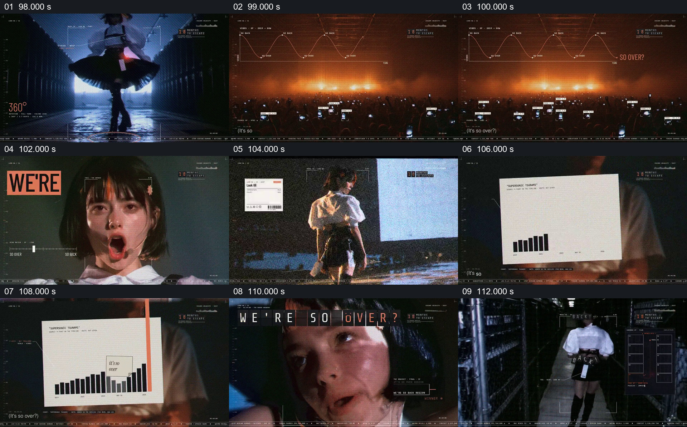

# 让人物、观众与图表轮流承载相反判断

- 作品：案例 004《人物影像、服饰与图形标注》，为原库索引名称。
- 原片范围：01:38.000–01:53.000，含起点、不含终点；[完整原片](../video.mp4)｜[本卡片段](c04.mp4)。
- 范围依据：从秀场人物转动和观众曲线开始，经人物与纸面图表的反向判断，到 BACK 带入下段。 范围与已有创意切片一致，复用既有切片和分镜。
- 观察方式与未确认范围：查看原片 64 帧总览和本卡九宫格；对原先未建卡的 74–98、164–184、250–275 秒补看逐秒源帧。未独立连续原速观看或听审，抽帧间动作、准确速度和声音配合仍待复核。画面中的数字、判断和界面均是作品呈现，设计价值为分析而非作者自述。

## 原画面具体怎样设计

98 秒附近，人物在蓝黑秀场中转身，裙摆与强背光形成醒目的轮廓。随后切到橙色灯光下举着手机的观众，画面上方是一条反复起伏的曲线，高低点分别标出 SO BACK 和 SO OVER；少量检测框落在手机附近。

人物脸部近景接上“WE'RE”等大字，左侧有两个端点的刻度；再转到人物站在大屏前的侧背影与手持白纸上的柱状图。纸面图表上有“it's so over”，随后人物面部近景显示“WE'RE SO OVER?”；最后背影画面出现“BACK”，接入下一组视觉。图表、人物和观众交替成为视觉中心，反向词汇反复出现。

## 为什么这样设计，好在哪里

同一对相反词既放在观众头顶的周期曲线上，又放到人物的表情和纸面图表附近，让抽象舆论变化有了不同的观看载体。曲线负责给出反复起落的模式，人物近景让其中一次判断具有表演性；两者交替才构成“反复摇摆”，不是单一一次结果公布。

曲线和柱状图在片中是设计元素，并非本次核实过的数据或调查结果。

## 可直接使用的创意指令

需要呈现观点之间反复摇摆时，先准备两种明确且语义相对的判断，并选择能代表公共反应的场景、能够传达处境的人物和可显示变化的图形。让观众先看见整体状态的起伏，再切到人物或实物呈现其中一次判断，之后回到另一种状态，以清楚的文字保留比较关系。

图形可用真实数据或明确标注的示意，角色、图表样式和色彩可调整；不能把未证实的曲线当实证，也不应在没有真实对立关系时制造虚假争议。

新题材中的迁移效果尚未实测。
