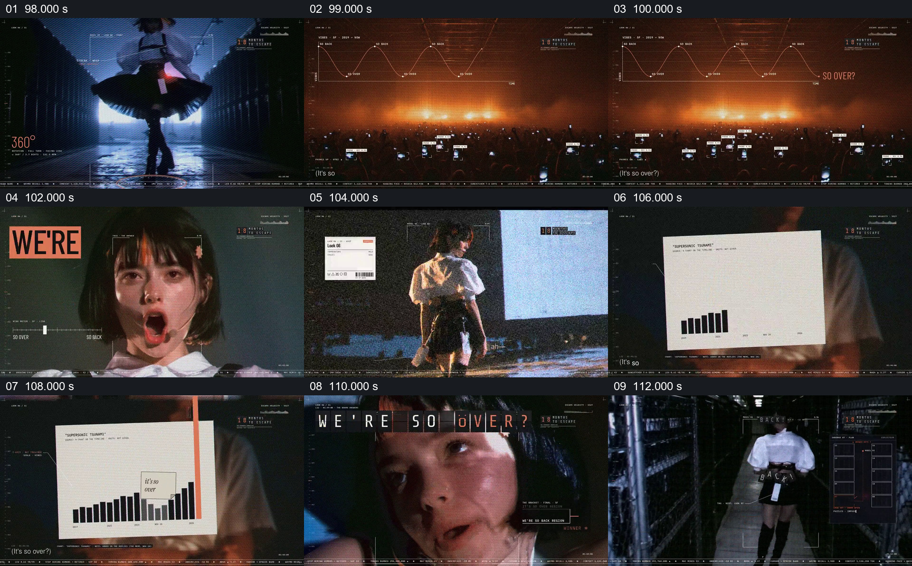

# 让人物、观众与图表轮流承载相反判断

- 作品：案例 004《人物影像、服饰与图形标注》，为原库索引名称。
- 原片范围：01:38.000–01:53.000，含起点、不含终点；[完整原片](../video.mp4)｜[本卡片段](c04.mp4)。
- 范围依据：从秀场人物转动和观众曲线开始，经人物与纸面图表的反向判断，到 BACK 带入下段。 范围与已有创意切片一致，复用既有切片和分镜。
- 观察方式与未确认范围：查看原片 64 帧总览和本卡九宫格；对原先未建卡的 74–98、164–184、250–275 秒补看逐秒源帧。未独立连续原速观看或听审，抽帧间动作、准确速度和声音配合仍待复核。画面中的数字、判断和界面均是作品呈现，设计价值为分析而非作者自述。

## 原画面具体怎样设计

98 秒附近，人物在蓝黑秀场中转身，裙摆与强背光形成醒目的轮廓。随后切到橙色灯光下举着手机的观众，画面上方是一条反复起伏的曲线，高低点分别标出 SO BACK 和 SO OVER；少量检测框落在手机附近。

人物脸部近景接上“WE'RE”等大字，左侧有两个端点的刻度；再转到人物站在大屏前的侧背影与手持白纸上的柱状图。纸面图表上有“it's so over”，随后人物面部近景显示“WE'RE SO OVER?”；最后背影画面出现“BACK”，接入下一组视觉。图表、人物和观众交替成为视觉中心，反向词汇反复出现。

## 为什么这样设计，好在哪里

同一对相反词既放在观众头顶的周期曲线上，又放到人物的表情和纸面图表附近，让抽象舆论变化有了不同的观看载体。曲线负责给出反复起落的模式，人物近景让其中一次判断具有表演性；两者交替才构成“反复摇摆”，不是单一一次结果公布。

曲线和柱状图在片中是设计元素，并非本次核实过的数据或调查结果。

## 完整照排指令

以[完整原片](../video.mp4)的 98–113 秒为准。画幅 1280×720，源帧率 24/1。以下拍点为抽帧定位，位置按画幅百分比取近似值。

### 用料

- 【观众远景】【表演正面】【舞台背面】【脸部近景】【离场影像】用同一场秀或有一致服装、色光、场地轴线的来源。人物正面与背面要可追踪，观众远景保留一排亮橙灯和零星发光屏。
- 【判断甲】【判断乙】为可简短对读的相反句。备【波形图】【柱形图】【图表标题】【图表注记】和【侧边识别票】。图表若承载事实，提供可打开资料、横纵轴、单位及覆盖时期。剧情图形标明演示，不能拿曲线形状证明判断。

### 按源时刻摆放

1. **98.000–约 101.000 秒。** 【观众远景】中间横向一条橙灯雾，下半人群暗面散布细白机屏。顶部叠【波形图】，细浅折线越过左至中上，右端用低饱和暖字露出【判断甲】，尺度远小于后段脸部字。人群、灯区和图形一起持续至切近景。
2. **约 101.000–105.000 秒。** 切到【表演正面】，脸和白色肩部接管中轴。短白大字在上方逐步拼出判断。切【舞台背面】，人落左半偏中，右面为冷白大屏，左处增奶白【侧边识别票】。服装身份跨镜保持，图表不要漂在人物头上。
3. **约 105.000–108.000 秒。** 背景转暗，近中位置压奶白【柱形图】卡，占画宽约六成、高约五成。卡里上方小黑【图表标题】，下部黑柱从左至右加高且含回落，右末柱升到高位并染成橙色，浮浅底小【图表注记】紧贴柱组。纸卡在肤色或衣着的残影前层，背景短暂可见，主体阅读交给柱图。
4. **约 108.000–111.000 秒。** 硬切【脸部近景】，红暗冷光混合，脸在左中占大幅。顶部用疏排白大字呈现【判断甲】，下一拍数字故障把近景分格错开，新的【判断乙】在前层沿不齐路径分散后重新可读。故障画面的像素块与字分开合成，不让两句重叠成一句。人物近景需在错格时继续有动作。
5. **约 111.000–113.000 秒。** 切【离场影像】，同一衣着的背影走进黑色走廊，中轴通向远处，白色【判断乙】的尾字短留再退出。保留走路方向，按 113.000 秒切出。

### 局部采用

只有两种判断与同一人近景，可用约 108–111 秒的故障换句。只有图表材料可用约 105–108 秒读出走势；相反判断须由前后内容交代。人群、脸及离场采用对应的动态段，图表可用静态面板分层显现。

### 验证状态

已对照原片逐秒画序并读回，检查橙灯远景上方折线、冷屏背影转奶白柱图、柱末橙色与脸部故障换句的顺序。精确动作帧、原速听看及换料试摆待核。
