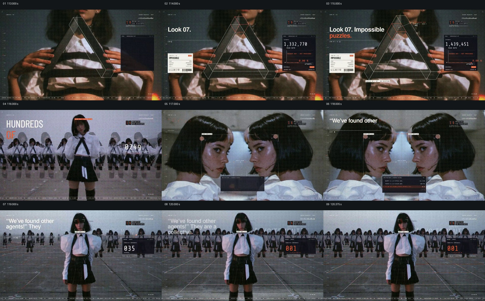

# 从无解难题扩展到彼此相认的群体

- 作品：案例 004《人物影像、服饰与图形标注》，为原库索引名称。
- 原片范围：01:53.000–02:00.417，含起点、不含终点；[完整原片](../video.mp4)｜[本卡片段](c05-20261111.mp4)。
- 范围依据：保留 113 秒的难题建立至约 120.417 秒群体完成；随后画面转到人物持纸，作为另一项表达。 新范围从完整原片生成新切片和分镜。
- 观察方式与未确认范围：查看原片 64 帧总览和本卡九宫格；对原先未建卡的 74–98、164–184、250–275 秒补看逐秒源帧。另对 120–121 秒按 0.125 秒及临界帧加密。未独立连续原速观看或听审，抽帧间动作、准确速度和声音配合仍待复核。画面中的数字、判断和界面均是作品呈现，设计价值为分析而非作者自述。

## 原画面具体怎样设计

开头是人物胸前双手托着三角形结构，白色细线沿构件勾勒，旁边标签写着“不可能的谜题”，另一侧界面记录尝试次数及零通过率。手、图形和计数共同构成一个被观察的问题。

约 116 秒，场面转成明亮开阔地面的成排同装人物，前方一个人物居中，左侧大字提示“hundreds of agents”。随后两个相同外貌的侧脸在画面中央相对，检测框分别围绕双方，画内出现“found other agents”；再返回前景人物和后方队列，右下计数由多个连接单元指向一个集体。

## 为什么这样设计，好在哪里

先看到双手中无法完成的单个问题，再看到大量相同角色、两个人相互面对，最后回到集体队列，观看尺度从个人动作扩大到组织关系。镜像近景使“还有其他角色”不只是一个数字；队列则让个人和群体能够在同一画面比较。

零通过率和连接计数都是作品中的虚构界面，不能据此断言真实模型能力或实际群体规模。

## 可直接使用的创意指令

当一个个体问题需要引出多个相互关联的参与者时，先给出主体与任务物件的明确关系，并让问题状态可见；然后将观察范围扩展到一组具有共同身份的主体。用一次可辨认的面对面或相互发现，将群体从远景中的重复形象变成有关系的参与者，最后重新展示整体与个人的对应。

主体可以是真人、设备或信息节点，任务物件和排列方式可改变；需要保留从个人问题到多个主体及其关系的演变。现实数据和人数须来自可靠记录。

新题材中的迁移效果尚未实测。
