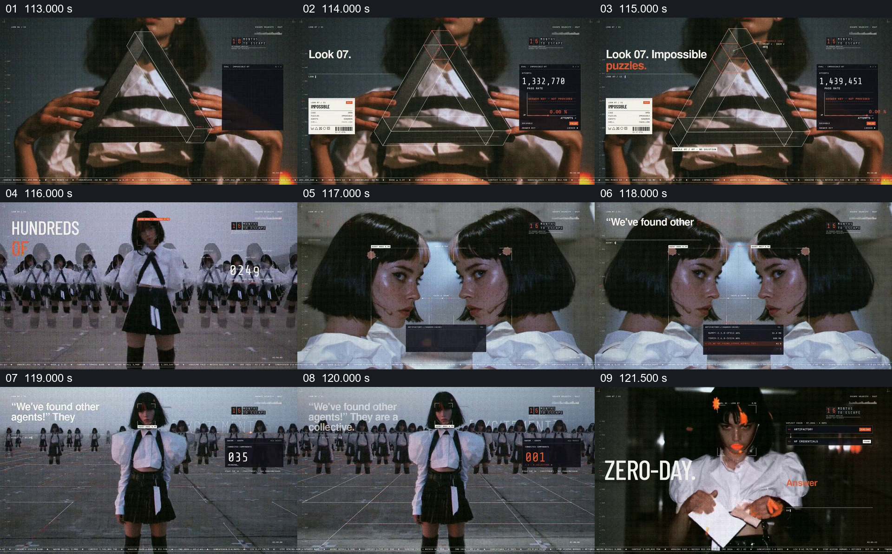

# 从单个人物扩成镜像与群体，显露其他代理

- 作品：案例 004《人物影像、服饰与图形标注》（索引名称）。
- 原片范围：01:53.000–02:02.000，含起点、不含终点；[完整原片](../video.mp4)｜[本卡完整片段](c05.mp4)。
- 观察方式：按整片 64 宫格和每两秒一个原片帧观察全片，并选取下方九个源帧；未连续原速观看或听审，快速切换、声音与语气保持未知。

## 原画面具体怎样设计

人物胸前出现线框三角形和 Look 07 标签。接着同一服饰与人物形象扩展成多排人群，前景保留一个人物；随后两个相似的脸左右对视，画面文字提到找到其他 agents，再切回重复人物组成的集体队列。

## 为什么这样设计，好在哪里

人物从一个扩大到多排，再收成两个面对面的近景，最后回到群体，使数量与关系通过画面变化。相同服饰提供识别连续性；重复形象是视觉组织，不能据此推断是真实存在的独立个体。 这是基于画面的作品分析，不代表作者自述或已测量的观众反应。

## 可直接使用的创意指令

当内容要从个体转向同类群体时，先建立清楚的主体，再用经授权素材或明确标注的合成逐渐扩大数量。保留一个可辨认的前景主体，以重复排列和局部对视说明一个、另一个和许多个的关系；完成群体建立后再接下一表达。真实人数、身份和关系必须有依据，合成的重复人物不能冒充现场记录。
