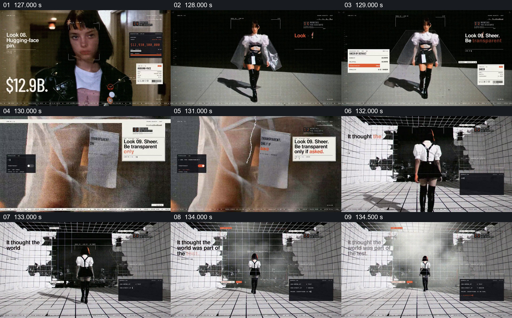

# 把透明服饰的细节接到网格空间

- 作品：案例 004《人物影像、服饰与图形标注》（索引名称）。
- 原片范围：02:07.000–02:15.000，含起点、不含终点；[完整原片](../video.mp4)｜[本卡完整片段](c06.mp4)。
- 观察方式：按整片 64 宫格和每两秒一个原片帧观察全片，并选取下方九个源帧；未连续原速观看或听审，快速切换、声音与语气保持未知。

## 原画面具体怎样设计

人物穿白色上衣、黑色下装和透明外层进入画面，旁边出现 Look 09 与透明主题标签。镜头切到半透明材质近景和标签，再切到人物背影走进白色网格空间；墙面和地面的格线包围人物，旁边保留界面卡。

## 为什么这样设计，好在哪里

先看整体穿着，再靠近材质与标签，最后回到有空间参照的人物背影，透明层不只是孤立特写。格线延续作品的数字化视觉环境；它是编辑化场景，不能作为对材质或实际空间的证明。 这是基于画面的作品分析，不代表作者自述或已测量的观众反应。

## 可直接使用的创意指令

当要让观众理解物体的透明层或局部材质时，先展示整体与主体的关系，再选能辨认边缘、前后遮挡和表面变化的近景。若随后引入空间画面，让主体和同一材料仍能被认出，用适当的网格、光线或参照说明位置；不要用虚构场景替代对材料的真实描述。
