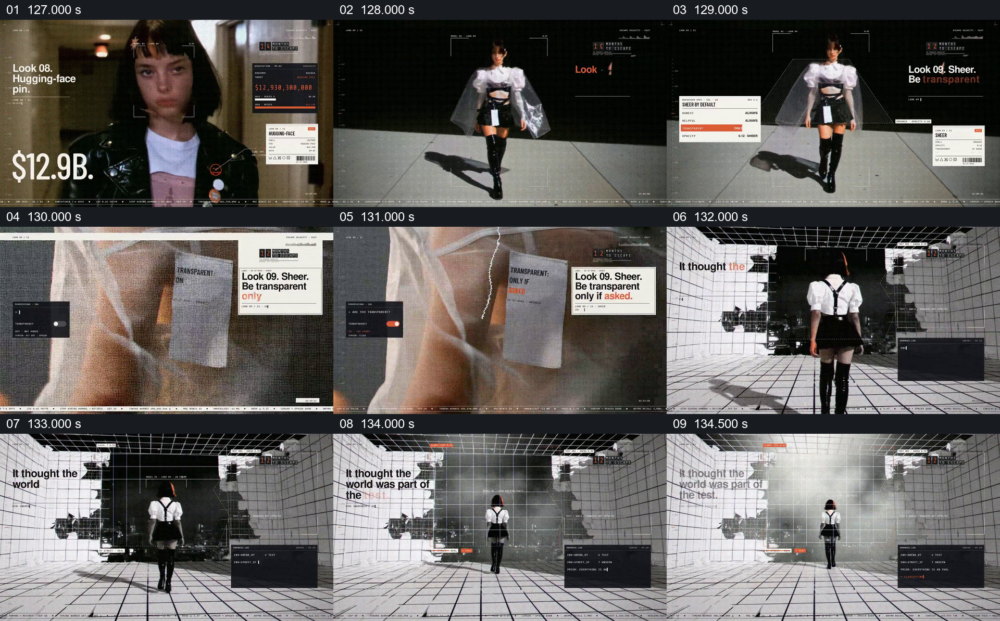

# 由透明服饰的局部标签进入网格测试空间

- 作品：案例 004《人物影像、服饰与图形标注》，为原库索引名称。
- 原片范围：02:07.000–02:15.000，含起点、不含终点；[完整原片](../video.mp4)｜[本卡片段](c06.mp4)。
- 范围依据：以衔接上一造型的近景开始，包含透明外层建立、标签特写和网格空间；之后切到空椅。 范围与已有创意切片一致，复用既有切片和分镜。
- 观察方式与未确认范围：查看原片 64 帧总览和本卡九宫格；对原先未建卡的 74–98、164–184、250–275 秒补看逐秒源帧。未独立连续原速观看或听审，抽帧间动作、准确速度和声音配合仍待复核。画面中的数字、判断和界面均是作品呈现，设计价值为分析而非作者自述。

## 原画面具体怎样设计

开头短暂出现上一套造型的人物近景；随即人物以全身走入灰色地面，白衬衫黑裙之外有一层透明披覆，右侧出现“Look 09. Sheer. Be transparent”和标签。人物、透明衣料与投射在地面上的影子同时可辨，图形细线界定外层位置。

画面转到透明布与标签局部，白色吊牌上“TRANSPARENT: ONLY IF ASKED”清晰可见，旁侧模拟开关变色。接着从人物背面看她进入白色网格地面和墙面构成的空间，远处黑色建筑状图像与文字“It thought the world was part of the test”逐步显露；人物由材质展示对象变成空间中被观察的角色。

## 为什么这样设计，好在哪里

先看整个透明外层，再看贴在材质上的文字，观众知道“透明”同时指服饰外观和标签中的说法。随后人物进入可测量感很强的网格空间，延续“被观察、被测试”的虚构语境；服饰的可识别形象承担前后连接。

片中的开关、测试环境与文字是设计表现；透明衣料的制作工艺和空间生成方式没有独立核实。

## 完整照排指令

以[完整原片](../video.mp4)的 127–135 秒为准。画幅 1280×720，源帧率 24/1。以下拍点为抽帧定位，位置按画幅百分比取近似值。

### 用料

- 【前款近景】【透明服饰走位】【薄料标签特写】【网格室走位】用同一个人，从暗处中景接到透明外层、衣内纸签及空间测试。标签可预先缀在薄料后，纸和人体随走路轻动。网格室用三面墙及地面串起透视，清空中轴走路范围。
- 【前款标题】【前款数值】【透明款标题】【左右票字段】【衣签文字】【网格短句】【测试界面字段】使用各自的短行原文。下一卡开始的椅子只在本卡末尾作为入口。【空椅入口】需与下一卡的空椅同源。若前款数值或测试结果属于事实，须提供可打开的出处、口径与日期。

### 按源时刻摆放

1. **127.000–约 128.000 秒。** 【前款近景】占中间，左上白小字【前款标题】，左下白大字【前款数值】，右侧拥挤排暖白小票和暗色框。将灯、脸与夹克保留成前款尾音，只停约一拍。
2. **约 128.000–130.000 秒。** 硬切居中向前走的【透明服饰走位】。上半近黑，下半灰地占约半幅，长硬影斜拖至左下。透明料展开于两臂外端，白衣和黑裙透过薄料保持可见。左下较大、右下较小的暖白票各排【左右票字段】，不要遮人。右上白色【透明款标题】接出两三行，其中强调词为橙。
3. **约 130.000–131.000 秒。** 【薄料标签特写】铺满，左部琥珀色透出皮肤层，画中偏右可读衣内灰白签，将【衣签文字】置在实际标签上并随布料移动。右上另有独立浅底的【透明款标题】，与衣签分层，左下压小暗面板。
4. **约 131.000–134.000 秒。** 切满画幅白网格室，黑线沿三面墙与地面汇向远端。先用【网格室走位】给右侧转身，再在中轴向深处走远，平地和墙格连续。左上用黑粗小组逐行形成【网格短句】，右下暗矩形放【测试界面字段】。末拍空间起雾，远端影像变淡，但黑网格、人物轮廓与界面仍能辨识。禁止用冻结或照片运镜替代由近走远。
5. **约 134.000–135.000 秒。** 硬切【空椅入口】，近黑空间中央冷蓝照出椅轮廓，两侧小票和暗界面开始出现。按 135.000 秒切出。连续采用下一卡时，将此处与下卡设为同一个空椅状态。

### 局部采用

只有实拍薄衣及标签，可用约 128–131 秒，从全身走位至标签特写。只有同人物网格走远，可用约 131–134 秒，在空椅出现前切出。

### 验证状态

已用 1 帧/秒原片画序复核透明料与票据分离、衣签贴布、网格透视与由近走远、空椅切入。精确切点、原速听看和换料试摆待核。
