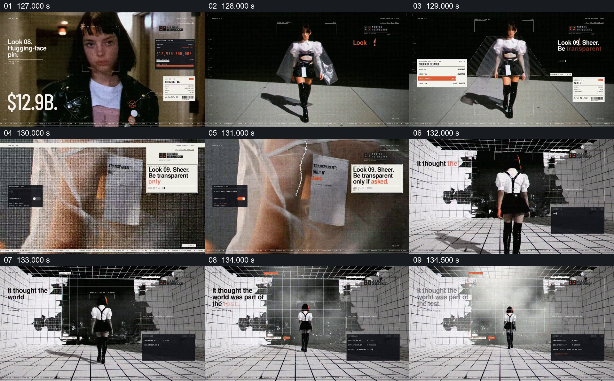

# 由透明服饰的局部标签进入网格测试空间

- 作品：案例 004《人物影像、服饰与图形标注》，为原库索引名称。
- 原片范围：02:07.000–02:15.000，含起点、不含终点；[完整原片](../video.mp4)｜[本卡片段](c06.mp4)。
- 范围依据：以衔接上一造型的近景开始，包含透明外层建立、标签特写和网格空间；之后切到空椅。 范围与已有创意切片一致，复用既有切片和分镜。
- 观察方式与未确认范围：查看原片 64 帧总览和本卡九宫格；对原先未建卡的 74–98、164–184、250–275 秒补看逐秒源帧。未独立连续原速观看或听审，抽帧间动作、准确速度和声音配合仍待复核。画面中的数字、判断和界面均是作品呈现，设计价值为分析而非作者自述。

## 原画面具体怎样设计

开头短暂出现上一套造型的人物近景；随即人物以全身走入灰色地面，白衬衫黑裙之外有一层透明披覆，右侧出现“Look 09. Sheer. Be transparent”和标签。人物、透明衣料与投射在地面上的影子同时可辨，图形细线界定外层位置。

画面转到透明布与标签局部，白色吊牌上“TRANSPARENT: ONLY IF ASKED”清晰可见，旁侧模拟开关变色。接着从人物背面看她进入白色网格地面和墙面构成的空间，远处黑色建筑状图像与文字“It thought the world was part of the test”逐步显露；人物由材质展示对象变成空间中被观察的角色。

## 为什么这样设计，好在哪里

先看整个透明外层，再看贴在材质上的文字，观众知道“透明”同时指服饰外观和标签中的说法。随后人物进入可测量感很强的网格空间，延续“被观察、被测试”的虚构语境；服饰的可识别形象承担前后连接。

片中的开关、测试环境与文字是设计表现；透明衣料的制作工艺和空间生成方式没有独立核实。

## 可直接使用的创意指令

当可见材料本身适合承载概念时，先用整体画面让观众辨认主体与材质，再靠近能读清或看清的具体细节，使标签、纹理或局部动作与概念相连。随后将同一主体带入一个能继续讨论该概念的环境，让此前观察过的材质成为持续参照。

透明材质、网格和文字都可替换，但不要丢掉“整体可辨—细节揭示—空间语境延续”的联系；缺乏真实材质细节时不能声称已展示其物理性质。

新题材中的迁移效果尚未实测。
