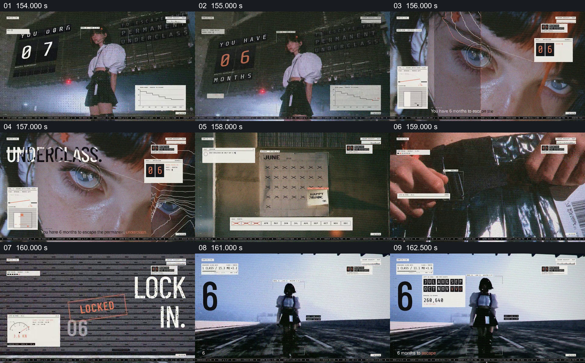

# 让人物、倒计时和日历共同显示剩余时间

- 作品：案例 004《人物影像、服饰与图形标注》（索引名称）。
- 原片范围：02:34.000–02:44.000，含起点、不含终点；[完整原片](../video.mp4)｜[本卡完整片段](c07.mp4)。
- 观察方式：按整片 64 宫格和每两秒一个原片帧观察全片，并选取下方九个源帧；未连续原速观看或听审，快速切换、声音与语气保持未知。

## 原画面具体怎样设计

人物旁的数字牌显示 07，切到眼部近景时数字变为 06；随后出现六月日历和被划记的日期，另一画面以“LOCKED IN.”与 06 等文字强调倒计时。人物走入明亮的空旷道路，画面保留大号数字 6 和月份条目。

## 为什么这样设计，好在哪里

大数字、眼部近景和日历在不同尺度间接力，使剩下六个月既有明确数量，也与人物状态关联。日历和锁定字样属于作品的叙事装置，不证明现实世界存在该截止日期或必然结果。 这是基于画面的作品分析，不代表作者自述或已测量的观众反应。

## 可直接使用的创意指令

当叙事有可靠期限或明确采用虚构倒计时时，先建立计数对象和所剩时间，再将数字变化与人物行动、日历或其他可理解的时间参照并置。保留统一单位和同一倒计时来源，切到新环境时让关键数字继续可辨；现实期限应注明来源和时间基准，不把估计值变成确定事件。
