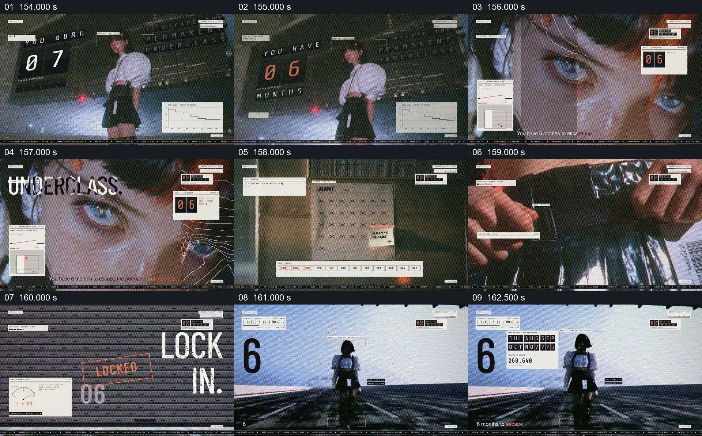

# 让剩余月份跨越人物、眼睛、日历与行动场地

- 作品：案例 004《人物影像、服饰与图形标注》，为原库索引名称。
- 原片范围：02:34.000–02:44.000，含起点、不含终点；[完整原片](../video.mp4)｜[本卡片段](c07.mp4)。
- 范围依据：从月份数字发生变化，到六个月被带到下一空间并形成明确时间参照。 范围与已有创意切片一致，复用既有切片和分镜。
- 观察方式与未确认范围：查看原片 64 帧总览和本卡九宫格；对原先未建卡的 74–98、164–184、250–275 秒补看逐秒源帧。未独立连续原速观看或听审，抽帧间动作、准确速度和声音配合仍待复核。画面中的数字、判断和界面均是作品呈现，设计价值为分析而非作者自述。

## 原画面具体怎样设计

人物站在深色环境中，左侧大数字从 07 变为 06 并配有 MONTHS，右上角保留小型剩余时间标记；人物和数字同在一个空间，底部是下降阶梯形图表。接着眼睛特写成为画面中心，细线和右侧小卡再次呈现 06。

下一组画面给出纸质日历，日期上有划线，底部还出现按月份排列的小格；手部和服饰锁扣局部之后，画面出现大型“LOCK IN”和印章样式的 LOCKED。随后人物进入明亮开阔的道路场景，左侧巨大数字 6 与月份格、人物并列，给后续内容留下时间参照。

## 为什么这样设计，好在哪里

同一个数字从舞台、眼睛、小卡、日历走到道路场景，在不同观察距离中反复可见；它既是文字信息，也附着在人物身体与行动空间附近。日历把抽象的六个月变成可看到的日期序列，锁扣和锁定字样则把时间压力转成可见动作与状态。

以上是画面含义分析；倒计时属于原片设定，不能作为真实预测。抽帧不足以确定数字翻转、动作与声音的精确节拍。

## 可直接使用的创意指令

当内容有可核实的期限或清楚标注的虚构倒计时时，先让人物与一个可读的时间单位同框，再在恰当的局部或日历载体上重复这一数字，帮助观众将期限与具体行动者关联。进入新空间或新任务时，保留简洁的时间参照，让前一阶段的信息有明确接续。

数字不必巨大，也不必使用眼睛、日历或锁扣；关键是期限、主体和将要发生的行动保持可辨认关系。日期、剩余量和单位必须与来源一致。

新题材中的迁移效果尚未实测。
