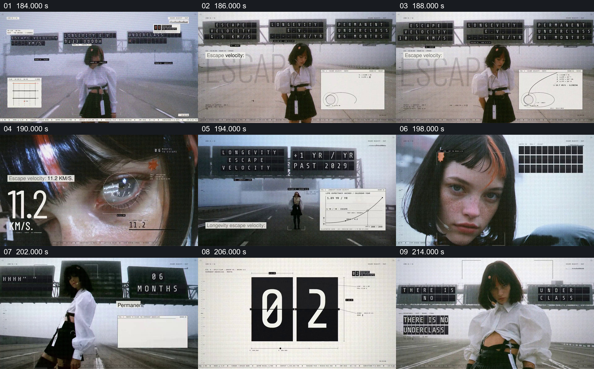

# 先并列三个“逃逸”概念，再逐项回到人物与图示

- 作品：案例 004《人物影像、服饰与图形标注》，为原库索引名称。
- 原片范围：03:04.000–03:36.000，含起点、不含终点；[完整原片](../video.mp4)｜[本卡片段](c08.mp4)。
- 范围依据：从三个道路牌同时建立，到三个含义轮流出现并形成“没有底层”的片中结论；下一段从结论接入奔跑。 范围与已有创意切片一致，复用既有切片和分镜。
- 观察方式与未确认范围：查看原片 64 帧总览和本卡九宫格；对原先未建卡的 74–98、164–184、250–275 秒补看逐秒源帧。未独立连续原速观看或听审，抽帧间动作、准确速度和声音配合仍待复核。画面中的数字、判断和界面均是作品呈现，设计价值为分析而非作者自述。

## 原画面具体怎样设计

开场是明亮道路空间，人物站在中央，上方三块黑色翻页式路牌并列，分别写 ESCAPE VELOCITY、LONGEVITY E.V. 和 PERMANENT UNDERCLASS；路牌与人物共享一幅画面，不同词条有各自的位置。

画面先突出普通逃逸速度：人物留在道路中，右侧白色图示卡出现地球圆形和轨迹，牌面数值变化，随后切到人物眼睛特写及 11.2 KM/S。第二项以远处人物、道路牌及上升曲线图并列，画面文字把寿命增长率与年份放在同一图内。

第三项回到人物与月份牌，黑色数字牌显示剩余时间并逐项变化；人物仍是贯穿这些抽象图示的参照。最后道路上方的翻页牌组合出“THERE IS NO UNDERCLASS”，人物近景与这句结论同框，后续转入另一段行动。

## 为什么这样设计，好在哪里

三个牌在最初同时出现，先把同一个词的三种使用摆成可比较的集合；分项时再让不同图示承担不同量纲：轨迹与速度、时间曲线、月份倒计时并非同一个数据。人物和路牌反复出现，使观众知道这些分项属于同一段论述。

“逃逸速度”的物理概念、片中寿命曲线和社会判断有不同证据要求；画面中的预测与结论仅是作品表达，不能因为并列而认为它们被共同证明。

## 可直接使用的创意指令

遇到几个共用名称但单位、条件或含义不同的概念时，先用并列的独立标签建立比较关系，保留每项专属名称和单位。随后每次只突出一项，选择与其内容确有对应的图示、真实材料或人物行为；在切换到下一项时，保留共同参照，让观众能把各项放回最初的集合。

最终结论应与已展示的信息相符，并标明不同论点的来源和限制。路牌、人物、线图和运动方式可替换，不能把不同量纲的数字直接混合成同一个指标。

新题材中的迁移效果尚未实测。
