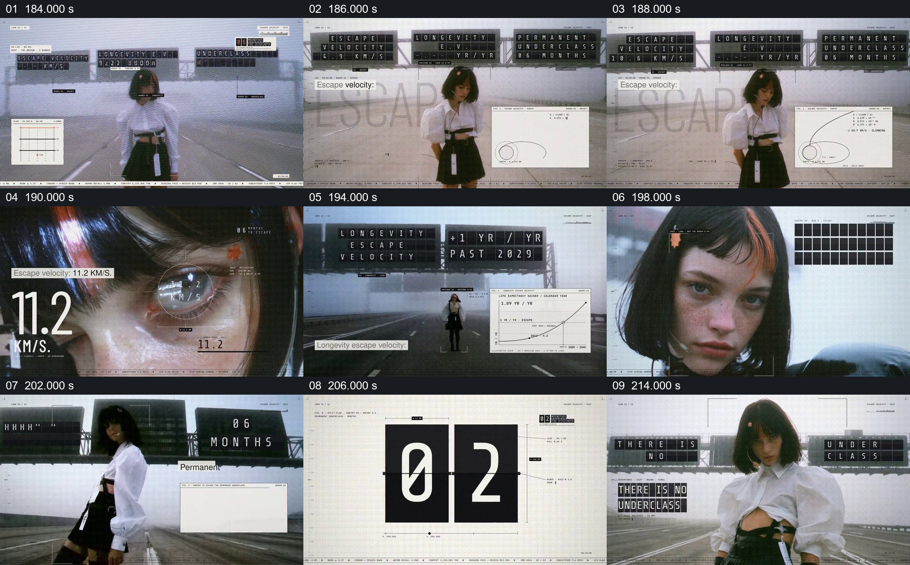

# 先并列三个“逃逸”概念，再逐项回到人物与图示

- 作品：案例 004《人物影像、服饰与图形标注》，为原库索引名称。
- 原片范围：03:04.000–03:36.000，含起点、不含终点；[完整原片](../video.mp4)｜[本卡片段](c08.mp4)。
- 范围依据：从三个道路牌同时建立，到三个含义轮流出现并形成“没有底层”的片中结论；下一段从结论接入奔跑。 范围与已有创意切片一致，复用既有切片和分镜。
- 观察方式与未确认范围：查看原片 64 帧总览和本卡九宫格；对原先未建卡的 74–98、164–184、250–275 秒补看逐秒源帧。未独立连续原速观看或听审，抽帧间动作、准确速度和声音配合仍待复核。画面中的数字、判断和界面均是作品呈现，设计价值为分析而非作者自述。

## 原画面具体怎样设计

开场是明亮道路空间，人物站在中央，上方三块黑色翻页式路牌并列，分别写 ESCAPE VELOCITY、LONGEVITY E.V. 和 PERMANENT UNDERCLASS；路牌与人物共享一幅画面，不同词条有各自的位置。

画面先突出普通逃逸速度：人物留在道路中，右侧白色图示卡出现地球圆形和轨迹，牌面数值变化，随后切到人物眼睛特写及 11.2 KM/S。第二项以远处人物、道路牌及上升曲线图并列，画面文字把寿命增长率与年份放在同一图内。

第三项回到人物与月份牌，黑色数字牌显示剩余时间并逐项变化；人物仍是贯穿这些抽象图示的参照。最后道路上方的翻页牌组合出“THERE IS NO UNDERCLASS”，人物近景与这句结论同框，后续转入另一段行动。

## 为什么这样设计，好在哪里

三个牌在最初同时出现，先把同一个词的三种使用摆成可比较的集合；分项时再让不同图示承担不同量纲：轨迹与速度、时间曲线、月份倒计时并非同一个数据。人物和路牌反复出现，使观众知道这些分项属于同一段论述。

“逃逸速度”的物理概念、片中寿命曲线和社会判断有不同证据要求；画面中的预测与结论仅是作品表达，不能因为并列而认为它们被共同证明。

## 完整照排指令

以[完整原片](../video.mp4)的 184–216 秒为准。画幅 1280×720，源帧率 24/1。以下拍点为抽帧定位，位置按画幅百分比取近似值。

### 用料

- 【跑道正面】【跑道侧面】【人物脸部】【眼部特写】【离场背影】由同一演员、同一可辨白衣黑裙构成；跑道地面线和架空牌保持同一空间关系。眼部允许用同场补拍，脸和身体动作不得以另一人物替代。
- 【概念牌甲】【概念牌乙】【概念牌丙】用可并列的短词。三概念各配【解释甲】【解释乙】【解释丙】、【示意甲】【示意乙】【示意丙】与【关键量甲】【年份步进】【时限步进】。图形各讲独立关系，给出图表原始入口、适用日期、单位和定义。剧情估算须标明设定。
- 另备【转折条件】【清零读数】【末段结论】【尾部图注】。前后沿用同一套名词，读数逐步清零作为演出。若结论来自文献，提供稳定可打开的来源与对应位置。

### 按源时刻摆放

1. **184.000–约 188.000 秒。** 【跑道正面】满铺，人物在中下、远端三块黑翻牌横排于高处，用白色等宽【概念牌甲】【概念牌乙】【概念牌丙】。先保留三牌与人物共处，轻灰背景上可见大的浅轮廓字。随后左上小白签单独落【解释甲】，右下暖白【示意甲】卡用细黑线表现轨道关系，人物仍在中轴。近镜不把三张牌拖到脸上。
2. **约 188.000–192.000 秒。** 切到【眼部特写】，睫毛、皮肤与反光占满，部分白数压眼球反射。随后用左下粗白大号【关键量甲】和单独小单位，眼部主位在中右，周围仅留少量细标。数稳住而眼球和反光仍动。再切拉远的跑道、雾和高架牌。
3. **约 192.000–198.000 秒。** 高处翻牌改突出【概念牌乙】，中下人物缩小，右下浅色【示意乙】从空白至细上升线，左下小条放【解释乙】。切到牌下较近景，左上黑底白数字格让【年份步进】逐位翻动，人物仰望，保持画顶牌架斜透视。此处曲线与年份共用一条叙述进程，但分别在不同版，不同时铺满。
4. **约 198.000–203.000 秒。** 【人物脸部】靠左，右边浅底翻牌短句和【转折条件】逐行出现，保持前景脸部清楚。切【跑道侧面】，人物走在地平线前，头顶翻牌以【概念牌丙】和【时限步进】分区表示，右下白底【示意丙】由空到下行线。与上一款上升线保持各自方向。
5. **约 203.000–211.000 秒。** 再切眼部，少量白色等宽数字【时限步进】压在瞳孔或其旁，倒数减少至末值。切回冷浅跑道，左半大黑【清零读数】，右边零位分次累加，人物仍居中偏右，下方路面线未消失。再切侧脸，左侧小黑【末段结论】开始出现，暗注记框叠在肩部外。
6. **约 211.000–216.000 秒。** 用跑道正面和较近腰部依次回看上方三牌，左边以黑底浅字小牌补【末段结论】。末段切到轻亮背景，人物侧身或转向，右半放细线图和【尾部图注】，按 216.000 秒截出。备眼部连读数、站姿和行进的连续源段，各自从露面到下一镜接管，禁止循环倒计或把人物冻结。翻牌和图卡允许静底分层动画。

### 局部采用

如只有一套图文材料，可用约 185–192 秒的第一项、约 192–198 秒的第二项，或约 200–207 秒的第三项和倒数。各窗及曲线应跟随对应概念，同一个数字不可在不同概念间混用。

### 验证状态

已对照 184–216 秒的逐秒原片画序并读回，核对三牌同场、三类小图更替、眼部倒数与跑道清零。图表文字逐字识读、快速切点、原速听看及换料待核。
