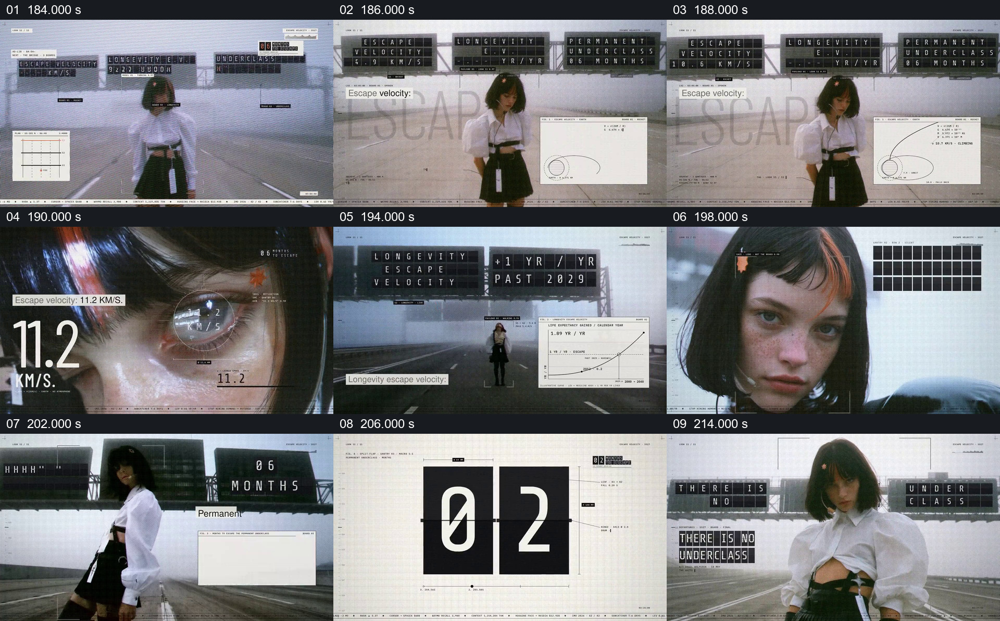

# 把三种逃逸概念放在同一组路牌上再逐项展开

- 作品：案例 004《人物影像、服饰与图形标注》（索引名称）。
- 原片范围：03:04.000–03:36.000，含起点、不含终点；[完整原片](../video.mp4)｜[本卡完整片段](c08.mp4)。
- 观察方式：按整片 64 宫格和每两秒一个原片帧观察全片，并选取下方九个源帧；未连续原速观看或听审，快速切换、声音与语气保持未知。

## 原画面具体怎样设计

空旷道路上方有三组电子路牌，分别出现 ESCAPE VELOCITY、LONGEVITY 和 PERMANENT UNDERCLASS 等文字，人物在道路中央。画面在人物与小型图表之间切换：一处出现 11.2 KM/S，另一处出现按年增长的文字与曲线，后面又出现 06 MONTHS 和递减数字。人物重新出现在道路上，电子字格写出“THERE IS NO UNDERCLASS”。

## 为什么这样设计，好在哪里

三块路牌先提供比较对象，随后用不同单位和图形逐项聚焦，持续的人物位置把抽象词句放进同一观看空间。速度、寿命预测和社会判断采用不同量纲与证据条件，不能仅因共享一个词就视为可以互相证明；原片不足以独立核实这些主张。 这是基于画面的作品分析，不代表作者自述或已测量的观众反应。

## 可直接使用的创意指令

当几个概念确有适合讨论的共同词或问题时，先并列写清每个对象，再逐项展示独立的条件、单位和来源；用持续场景或人物作为参照，不把不同指标画成同一量表。说明比较的是表达方式还是实际数值；预测、不确定性或虚构判断应标注，结论只采用来源允许的范围。
