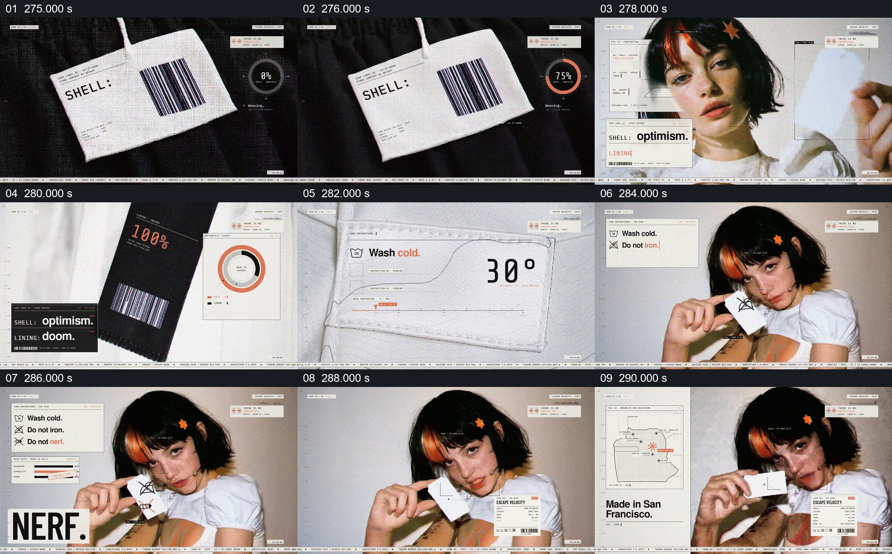

# 把外层、内衬和洗涤说明变成一组相反情绪

- 作品：案例 004《人物影像、服饰与图形标注》，为原库索引名称。
- 原片范围：04:35.000–04:51.000，含起点、不含终点；[完整原片](../video.mp4)｜[本卡片段](c09.mp4)。
- 范围依据：从条形码吊牌建立，到内外层与护理规则显露并回到人物；291 秒开始谢幕。 范围与已有创意切片一致，复用既有切片和分镜。
- 观察方式与未确认范围：查看原片 64 帧总览和本卡九宫格；对原先未建卡的 74–98、164–184、250–275 秒补看逐秒源帧。未独立连续原速观看或听审，抽帧间动作、准确速度和声音配合仍待复核。画面中的数字、判断和界面均是作品呈现，设计价值为分析而非作者自述。

## 原画面具体怎样设计

画面先特写挂在黑色衣物上的白色条形码标签，标签写“SHELL”，旁边的圆形百分比逐步变化。随后人物近景与手中的小纸卡出现，屏幕上的标签面板填入“SHELL: optimism”和“LINING: doom”；另一张黑色标签与圆环图继续区分外层与内衬。

接下来衣物内侧的护理说明占据画面，Wash cold、30° 及曲线、刻度在布面附近出现。人物举起白色小标签靠近脸部，左上方逐项显示“Wash cold”“Do not iron”“Do not nerf”；最后旁侧补出产地样式卡，人物与标签仍同框。

## 为什么这样设计，好在哪里

“外层／内衬”原本就是服饰标签中的材料分类，被用来承载乐观与悲观两种相反词；因此对照并非悬空文字，而附着在观众已经看见的实物结构中。洗涤说明继续沿用同一载体，将服饰护理语言与技术词语并列，保留了前后统一的物件逻辑。

这些情绪词和规则是影片中的修辞与虚构设计，不代表真实面料成分或产品护理说明。

## 完整照排指令

以[完整原片](../video.mp4)的 275–291 秒为准。画幅 1280×720，源帧率 24/1。以下拍点为抽帧定位，位置按画幅百分比取近似值。

### 用料

- 【外层吊牌】【内衬吊牌】【洗涤说明实物】【举牌人物】【产地标签】【空场人物】必须能够认作同一衣物和同一表演者。外层、内衬可以使用两张正反对比标签，均带可辨细码区。人物须手持实际标签到脸侧并完成翻动。
- 【外层词】【内衬词】分别对应相反的短词，与条码同页。【外层占比】【内衬占比】如为服装成分须能核实，虚构词与占比按剧情处理。【温度值】【洗涤条目】【强调短字】【产地短语】【末段翻牌字】按原画位准备。真实洗护、产地等声明需有原标签照片或可打开的出处。

### 按源时刻摆放

1. **275.000–约 279.000 秒。** 【外层吊牌】斜压深黑织物，奶白长方签左半用黑印字和大【外层占比】，右半竖黑条码。右侧暗区另放暖色圆形百分圈，先填小段再完成。切人物脸和举签细节，左侧浅票指定【外层词】，重点暖橙。让脸和标签同时可见。约 279 秒以近全黑的窄缝划开正反。
2. **约 280.000–283.000 秒。** 换偏白背景和深底【内衬吊牌】，斜签上用暖橙【内衬占比】与浅码区。左下暗小栏并排或上下排【外层词】【内衬词】，右侧保留圆表。切【洗涤说明实物】，白织物纹理占满，印刷文本沿面料固有角度，先现短细线图再放黑大【温度值】，让温度和面料同层。
3. **约 283.000–289.000 秒。** 【举牌人物】贴中右，白标签举至脸颊外。左上奶白小卡由一行增加为三条【洗涤条目】，图标与每行左对齐；左下另以黑大字短闪【强调短字】。持牌片从脸旁举起到翻面不能断动作、循环或定格。后段左侧白面板改图文，沿实际【产地标签】读到右脸外的纸签；【产地短语】在左面板下部，重点词转橙。纸上说明固定到纸，左侧界面固定到画。
4. **约 289.000–291.000 秒。** 硬切【空场人物】，灰白空场中同一人缩小于中间，右面显示【末段翻牌字】黑格与细字，下方小浅票辅助。不盖住四肢。到 291.000 秒接下段。

### 局部采用

只有外层与内衬标签，可用 275–约 283 秒。只有确切洗涤条目及人物举牌，可用约 283–289 秒。品牌信息或年代缺失时，删去相应断言并缩短该拍。

### 验证状态

已对照逐秒原片画序并读回，检查白外签与黑内签、温度贴布、洗涤条目累积与手持翻面的先后。逐帧切点、原速听看和换料试摆待核。
