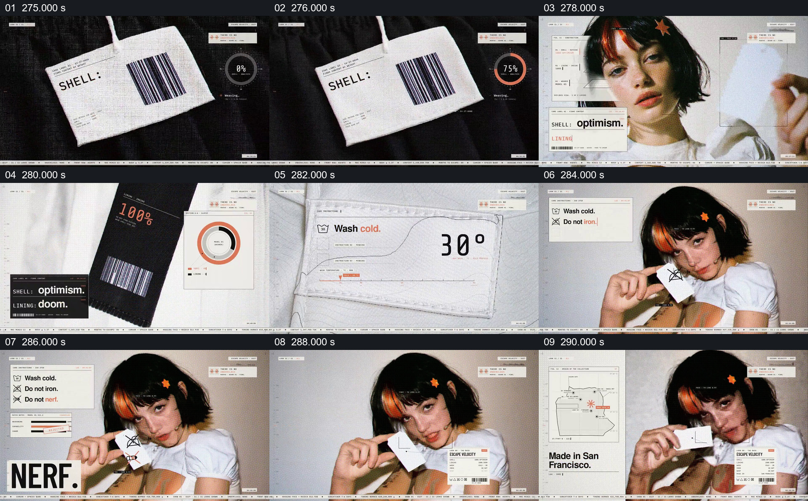

# 把外层、内衬和洗涤说明变成一组相反情绪

- 作品：案例 004《人物影像、服饰与图形标注》，为原库索引名称。
- 原片范围：04:35.000–04:51.000，含起点、不含终点；[完整原片](../video.mp4)｜[本卡片段](c09.mp4)。
- 范围依据：从条形码吊牌建立，到内外层与护理规则显露并回到人物；291 秒开始谢幕。 范围与已有创意切片一致，复用既有切片和分镜。
- 观察方式与未确认范围：查看原片 64 帧总览和本卡九宫格；对原先未建卡的 74–98、164–184、250–275 秒补看逐秒源帧。未独立连续原速观看或听审，抽帧间动作、准确速度和声音配合仍待复核。画面中的数字、判断和界面均是作品呈现，设计价值为分析而非作者自述。

## 原画面具体怎样设计

画面先特写挂在黑色衣物上的白色条形码标签，标签写“SHELL”，旁边的圆形百分比逐步变化。随后人物近景与手中的小纸卡出现，屏幕上的标签面板填入“SHELL: optimism”和“LINING: doom”；另一张黑色标签与圆环图继续区分外层与内衬。

接下来衣物内侧的护理说明占据画面，Wash cold、30° 及曲线、刻度在布面附近出现。人物举起白色小标签靠近脸部，左上方逐项显示“Wash cold”“Do not iron”“Do not nerf”；最后旁侧补出产地样式卡，人物与标签仍同框。

## 为什么这样设计，好在哪里

“外层／内衬”原本就是服饰标签中的材料分类，被用来承载乐观与悲观两种相反词；因此对照并非悬空文字，而附着在观众已经看见的实物结构中。洗涤说明继续沿用同一载体，将服饰护理语言与技术词语并列，保留了前后统一的物件逻辑。

这些情绪词和规则是影片中的修辞与虚构设计，不代表真实面料成分或产品护理说明。

## 可直接使用的创意指令

选择一个具有可辨认内部结构或使用规则的真实物件，例如包装的内外层、说明书或设备状态标签。先让观众看见物件及其原有标签结构，再把需要对照的两种状态分别放入有意义的位置，最后用该物件特有的说明方式延续观点，而不是简单叠两行形容词。

物件、对照词、材质和视觉符号可替换；保留实物结构与表达内容之间的对应。实际商品成分、护理方式或医疗信息必须准确，修辞示意须明确。

新题材中的迁移效果尚未实测。
