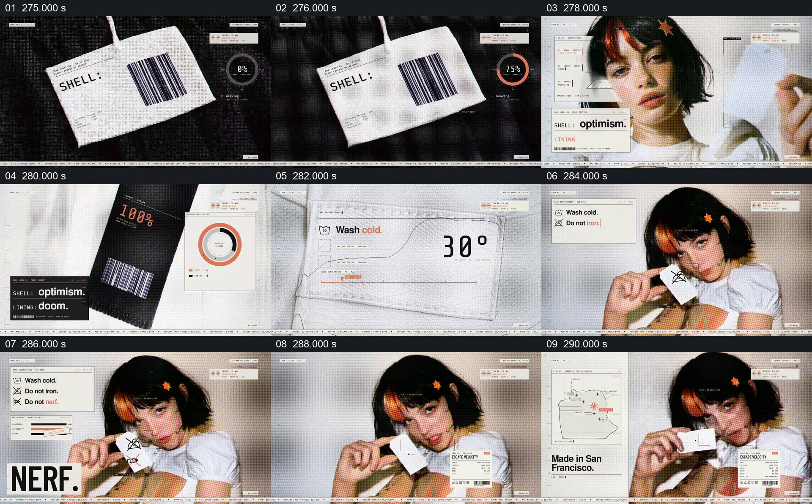

# 借衣服标签和洗涤说明表达矛盾情绪

- 作品：案例 004《人物影像、服饰与图形标注》（索引名称）。
- 原片范围：04:35.000–04:51.000，含起点、不含终点；[完整原片](../video.mp4)｜[本卡完整片段](c09.mp4)。
- 观察方式：按整片 64 宫格和每两秒一个原片帧观察全片，并选取下方九个源帧；未连续原速观看或听审，快速切换、声音与语气保持未知。

## 原画面具体怎样设计

近景中的衣服吊牌带 SHELL 与条码；切回人物后，卡片补出“SHELL: optimism”，另一张标签出现“LINING: doom”。镜头转向服饰与洗涤标签，画面逐项显示“Wash cold”“Do not iron”“Do not nerf”，人物举起带符号的白色小牌，周围保留标签式信息。

## 为什么这样设计，好在哪里

衣服原本就有外层、内衬和保养标签，把乐观与悲观放进这些栏目，借材料结构形成对照；洗涤规则里加入技术词，延续同一物件逻辑而产生语义变化。这是比喻和幽默，不是实际面料或人物心理的可靠陈述。 这是基于画面的作品分析，不代表作者自述或已测量的观众反应。

## 可直接使用的创意指令

当物件原本具有可理解的部件、成分或说明，且它们与两种状态有合适类比时，先让观众看见物件及其标签结构，再把对照概念放到对应位置。可在同一规则中补出与主题相关的短语，最后回到主体或物件并保留阅读结果。真实材质、安全说明或个人状态应保留准确原信息，创作性改写明确作为比喻。
