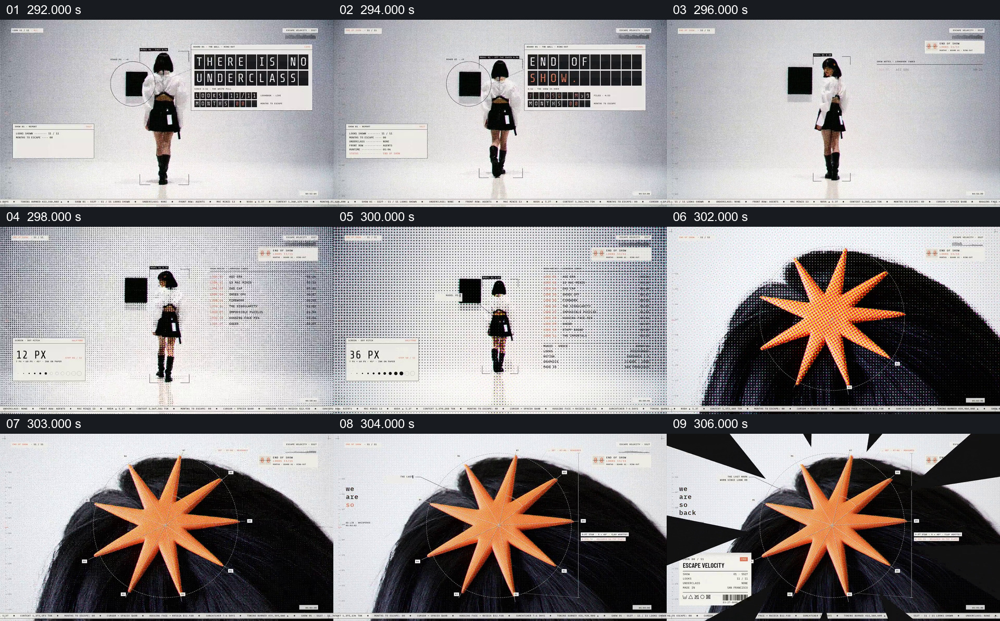

# 让谢幕回到整体人物，最后放大一直佩戴的标识

- 作品：案例 004《人物影像、服饰与图形标注》，为原库索引名称。
- 原片范围：04:51.000–05:06.480，含起点、不含终点；[完整原片](../video.mp4)｜[本卡片段](c10.mp4)。
- 范围依据：从谢幕文字及人物站在白色空间开始，至头饰被放大、放射画面完成片尾；覆盖原文件结尾。 范围与已有创意切片一致，复用既有切片和分镜。
- 观察方式与未确认范围：查看原片 64 帧总览和本卡九宫格；对原先未建卡的 74–98、164–184、250–275 秒补看逐秒源帧。未独立连续原速观看或听审，抽帧间动作、准确速度和声音配合仍待复核。画面中的数字、判断和界面均是作品呈现，设计价值为分析而非作者自述。

## 原画面具体怎样设计

明亮白色空间里，人物背对镜头站在中间，左侧黑色矩形与右侧翻页式看板并列；看板由“THERE IS NO UNDERCLASS”转为“END OF SHOW”，旁边小型信息框汇总展示状态。人物仍占全身高度，文字和信息框围绕她而非替代她。

随后画面保留人物和黑色方块，点阵纹理逐渐更明显，右侧出现多行造型清单和信息；人物在整体空间里变得更小。接着镜头切到黑色头发上的橙色星形饰物特写，饰物占据大部分画面，周围附有细小标记；最后黑白放射形状向外扩展，旁边可见“we are so back”等文字。

## 为什么这样设计，好在哪里

先用全身人物与结束牌明确系列已经走到尾声，再把前面反复出现的小头饰放大，让片尾从完整演出缩到一个可识别的细节；点阵与清单则把整体作品回顾与局部特写连在一起。

头饰之所以能承担收束，是因为它此前已多次随人物出现；换成一个全新、没有建立过的装饰，观众就较难把它读成整片的回扣。抽帧不能证明最后的放射图形与音乐有何同步关系。

## 可直接使用的创意指令

为系列展示或人物作品设计结尾时，先找到此前确实多次出现、容易辨认的主体细节或标识。以一个能够看清人物或整体状态的谢幕画面交代结束，再逐渐或通过合适的镜头转移到这个细节，让它成为最终视觉中心；必要时在旁保留简短、准确的结束信息。

标识可以是配饰、产品细节、颜色或空间物件，不必使用点阵、星形或放射线；必须让观众能从前文认识它。若前文没有建立共同标识，应先补充真实的连接素材。

新题材中的迁移效果尚未实测。
