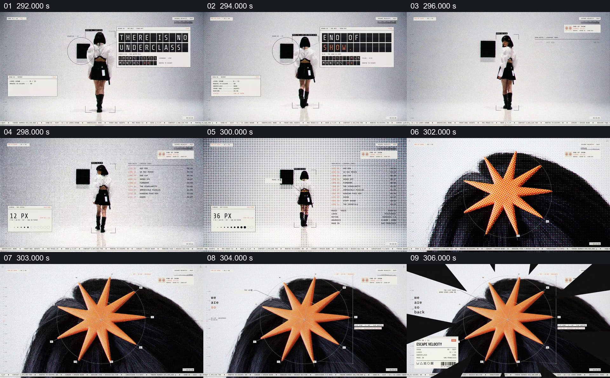

# 把人物识别点放大成演出的结束标记

- 作品：案例 004《人物影像、服饰与图形标注》（索引名称）。
- 原片范围：04:51.000–05:06.480，含起点、不含终点；[完整原片](../video.mp4)｜[本卡完整片段](c10.mp4)。
- 观察方式：按整片 64 宫格和每两秒一个原片帧观察全片，并选取下方九个源帧；未连续原速观看或听审，快速切换、声音与语气保持未知。

## 原画面具体怎样设计

人物背对镜头立于白色空间，旁边电子字格显示“THERE IS NO UNDERCLASS”，随后出现“END OF SHOW”。人物留在中央，网格逐步粗化，旁边数字标出像素大小；镜头落到头发上的橙色星形，星形放大，周围出现测量框和短文字，最后以黑白放射形收尾。

## 为什么这样设计，好在哪里

此前人物一直带着同样的橙色头饰，结尾将可识别的小细节放大为主要画面，使收束来自人物自身。网格粗化提供观察尺度变化，星形接管给长段演出一个视觉终点。 这是基于画面的作品分析，不代表作者自述或已测量的观众反应。

## 可直接使用的创意指令

当主体有前文建立过、观众能够认出的细节时，先让主体和结束状态共同可见，再通过靠近、放大或尺度变化把注意交给这个细节。保留原主体参照，让观众知道放大对象来自哪里；让该细节成为最终形状或标识，再接必要的结束文字。不要为形式遮掉尚未完成的重要信息。
