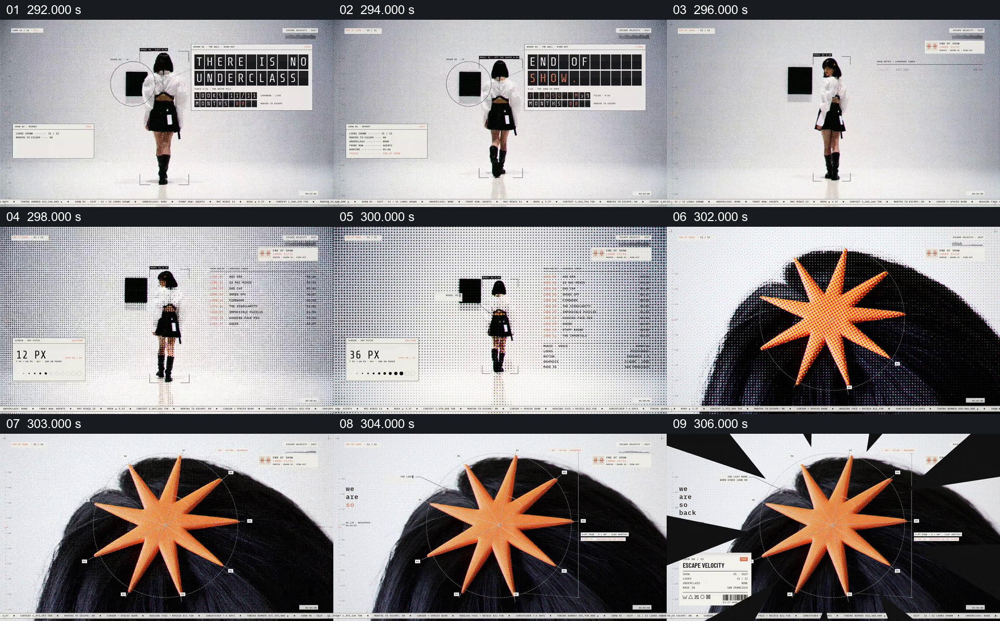

# 让谢幕回到整体人物，最后放大一直佩戴的标识

- 作品：案例 004《人物影像、服饰与图形标注》，为原库索引名称。
- 原片范围：04:51.000–05:06.480，含起点、不含终点；[完整原片](../video.mp4)｜[本卡片段](c10.mp4)。
- 范围依据：从谢幕文字及人物站在白色空间开始，至头饰被放大、放射画面完成片尾；覆盖原文件结尾。 范围与已有创意切片一致，复用既有切片和分镜。
- 观察方式与未确认范围：查看原片 64 帧总览和本卡九宫格；对原先未建卡的 74–98、164–184、250–275 秒补看逐秒源帧。未独立连续原速观看或听审，抽帧间动作、准确速度和声音配合仍待复核。画面中的数字、判断和界面均是作品呈现，设计价值为分析而非作者自述。

## 原画面具体怎样设计

明亮白色空间里，人物背对镜头站在中间，左侧黑色矩形与右侧翻页式看板并列；看板由“THERE IS NO UNDERCLASS”转为“END OF SHOW”，旁边小型信息框汇总展示状态。人物仍占全身高度，文字和信息框围绕她而非替代她。

随后画面保留人物和黑色方块，点阵纹理逐渐更明显，右侧出现多行造型清单和信息；人物在整体空间里变得更小。接着镜头切到黑色头发上的橙色星形饰物特写，饰物占据大部分画面，周围附有细小标记；最后黑白放射形状向外扩展，旁边可见“we are so back”等文字。

## 为什么这样设计，好在哪里

先用全身人物与结束牌明确系列已经走到尾声，再把前面反复出现的小头饰放大，让片尾从完整演出缩到一个可识别的细节；点阵与清单则把整体作品回顾与局部特写连在一起。

头饰之所以能承担收束，是因为它此前已多次随人物出现；换成一个全新、没有建立过的装饰，观众就较难把它读成整片的回扣。抽帧不能证明最后的放射图形与音乐有何同步关系。

## 完整照排指令

以[完整原片](../video.mp4)的 291–306.48 秒为准。画幅 1280×720，源帧率 24/1。以下拍点为抽帧定位，位置按画幅百分比取近似值。

### 用料

- 【谢幕全身】用同一表演者在灰白空场内由背转侧的全身连续素材，保留头部佩戴物和衣服吊签。【佩戴物特写】取这名表演者同一个标记，边缘须清楚，给留出细线指示空间。
- 【谢幕翻牌字】【检测字段】【像素读数】【标识票字段】为画中短词、数和记录行。若读数意指实际量测，附测量方法和可打开记录；虚构读数用剧情口径。

### 按源时刻摆放

1. **291.000–约 296.000 秒。** 灰白底满铺，【谢幕全身】缩在中轴，头在约 y20%，鞋至约 y78%。人物背面开始，右上约三分之一宽的白矩形中多排黑小格排【谢幕翻牌字】，白字逐格翻换。左下小白票跟随不动，人物左侧保留一个暗方块。保持屏幕格与实际服饰分层。
2. **约 296.000–301.000 秒。** 翻牌退去，右侧改为散排细黑【检测字段】，冷灰底由平整变成可见浅网格。画面左下白票出现【像素读数】，位数与下方小点随时间变化。【谢幕全身】继续周转并稳定，主体缩小程度保持，不循环动作。
3. **约 301.000–306.480 秒。** 切【佩戴物特写】。深色头发扩大成下半至右侧的圆弧，明亮橙色标记从居中偏左伸出多尖，四周薄白图线与小点贴着标记的尖与轮廓建立。右侧留短引线和小字，后段左下加小白【标识票字段】，避过最大橙尖。可用同一人的高清静帧做细微运镜与点线显现，标记始终是主图。至索引末尾切出。

### 局部采用

只有可证实佩戴关系和清晰特写，可用约 301 秒至片尾的标识读图；谢幕加特写需要全身上可辨同一物件。

### 验证状态

已对照原片逐秒画序，核对翻牌退场、细网格与人物周转、橙标特写及检测线，并读回正文。快速切点、原速听看和换料待核。
