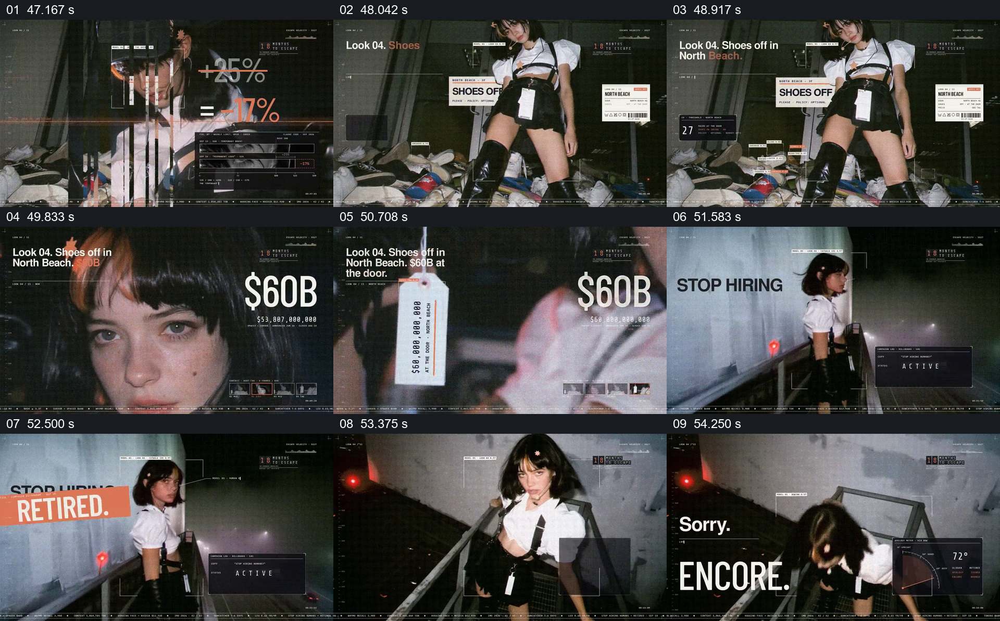

# 用造型标签和退休印章组合一则讽刺

- 作品：案例 004《人物影像、服饰与图形标注》（索引名称）。
- 原片范围：00:47.000–00:55.000，含起点、不含终点；[完整原片](../video.mp4)｜[本卡片段](c11.mp4)。
- 观察方式：按整片 64 宫格及每秒一次真实源帧复核，抽看本段九个源帧；未连续原速观看或听审，快速切换和声音保持未知。

## 原画面具体怎样设计

人物以白上衣和黑色下装站在杂物之间，旁边出现“Look 04”和“SHOES OFF”等吊牌式文字；画面切到面部近景，叠加大号“$60B”。随后人物位于走廊，“STOP HIRING HUMANS?”旁被“RETIRED”字样覆盖，接着另一镜头出现“Sorry.”和橙色“ENCORE.”。

## 为什么这样设计，好在哪里

同一套服装把金额、工作状态和演出式回应放进一个连续场面；覆盖印章与大标题把观点做成可迅速识别的视觉冲突。这些数字及就业说法是片中的讽刺表达，本次没有独立核实。

以上为依据画面的分析，非作者自述；预期观看效果未经观众测试。

## 可直接使用的创意指令

当评论或虚构作品确实需要用一套造型承载观点时，先让人物的穿着和处境被看清，再把与观点有关的短标签放在人物附近，用状态印章或相反措辞回应前面的判断；保留对象不变，使观众能比较变化。若引用真实金额、岗位或事件，应写明来源、口径和时间，虚构标签不能冒充事实。
