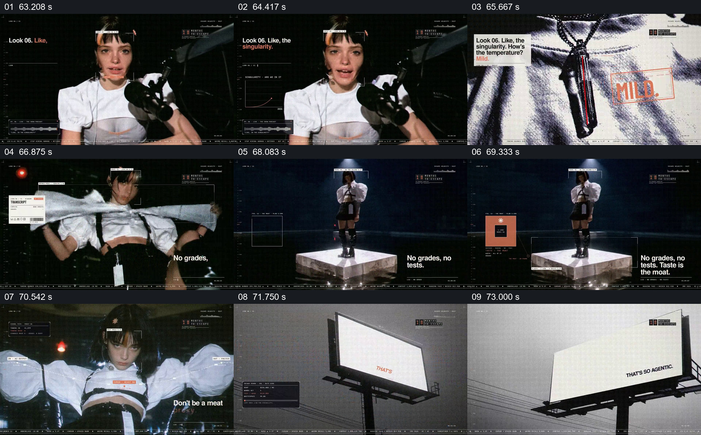

# 让人物、成绩单和广告牌接力呈现一组短句

- 作品：案例 004《人物影像、服饰与图形标注》（索引名称）。
- 原片范围：01:03.000–01:14.000，含起点、不含终点；[完整原片](../video.mp4)｜[本卡片段](c12.mp4)。
- 观察方式：按整片 64 宫格及每秒一次真实源帧复核，抽看本段九个源帧；未连续原速观看或听审，快速切换和声音保持未知。

## 原画面具体怎样设计

人物手持麦克风面对镜头，左侧出现“Look 06”及短句和小图表；随后人物拉开一张白色长纸，画面切到其站在发光平台上的全身，旁边逐步显示“No grades, no tests.”等文字。之后切到室外高处的白色广告牌，上面依次出现短语。

## 为什么这样设计，好在哪里

短句没有一直悬在同一张近景上，而是依次落在人物、纸张、平台和广告牌周围；共同的黑白与细小界面样式使这些载体属于同一作品。片中口号是艺术表达，纸张或图表不能证明相关教育和技术结论。

以上为依据画面的分析，非作者自述；预期观看效果未经观众测试。

## 可直接使用的创意指令

当一段观点需要跨人物表演和环境载体延续时，先用人物及具体道具建立表达者，再让同一组简短信息依次出现在纸面、人物全身与场景中的实体标牌上；每次保留足够可读空间，避免把不同句子同时堆满。现实主张另附可靠依据，载体和动作随实际素材调整。
