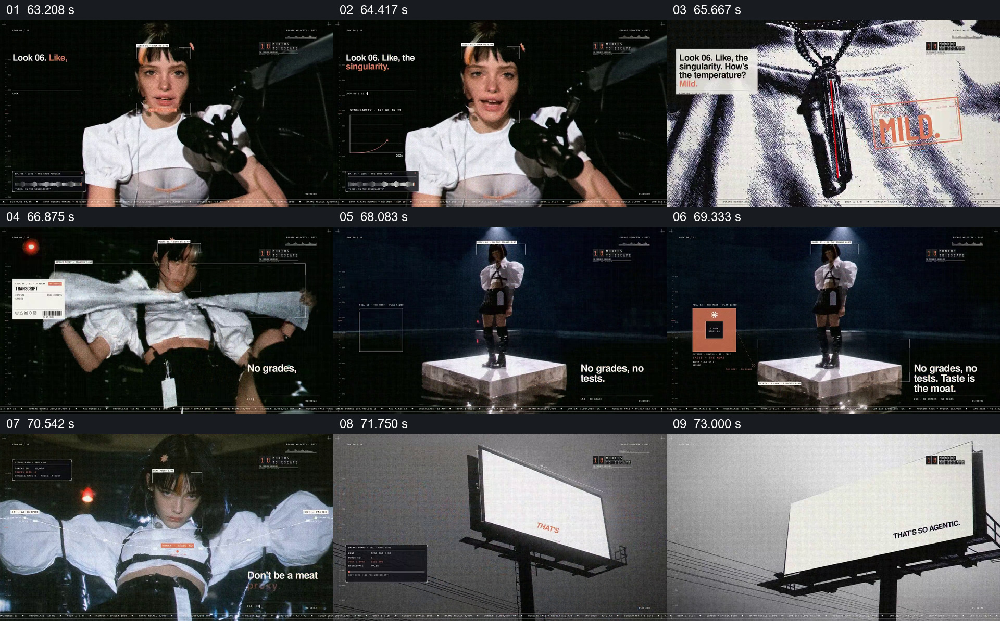

# 让一段评价经过人物、物件和广告牌三次显形

- 作品：案例 004《人物影像、服饰与图形标注》，为原库索引名称。
- 原片范围：01:03.000–01:14.000，含起点、不含终点；[完整原片](../video.mp4)｜[本卡片段](c12.mp4)。
- 范围依据：人物与麦克风建立，经过衣服细节、台上人物及广告牌，广告牌文字完整后结束。 范围与已有创意切片一致，复用既有切片和分镜。
- 观察方式与未确认范围：查看原片 64 帧总览和本卡九宫格；对原先未建卡的 74–98、164–184、250–275 秒补看逐秒源帧。未独立连续原速观看或听审，抽帧间动作、准确速度和声音配合仍待复核。画面中的数字、判断和界面均是作品呈现，设计价值为分析而非作者自述。

## 原画面具体怎样设计

人物正面对着右侧麦克风，脸和上身占据画面中心；左侧“Look 06”与逐步增加的短句并列，底部有小型波形样式界面。接着出现衣服拉链与温度样式特写，文字转为“MILD”；再回到人物张开双臂、手边白色长条和衣服标签。

观察距离拉到远处，人物独自站在深色空间里的一块明亮方形台座上；“No grades, no tests”在右下方，旁边的示意卡与线条把台座纳入画面。之后人物再次近景，画面转到户外广告牌；白色牌面从简短文字发展成“THAT'S SO AGENTIC.”，形成与人物段不同的最终载体。

## 为什么这样设计，好在哪里

相同观点从人物口边进入服饰细节，再被放到独立台座与户外牌面，观看位置从私人近距离扩大到公共空间。台座周围的暗色留白让身体和文字同时可辨，广告牌则把一句评价变成场景中真实可见的物件。

这是一种对画面组织的分析，不能仅凭嘴型或波形图断言实际语音和音乐节奏。

## 完整照排指令

以[完整原片](../video.mp4)的 63–74 秒为准。画幅 1280×720，源帧率 24/1。以下拍点为抽帧定位，位置按画幅百分比取近似值。

### 用料

- 【麦前表演】【服饰展开】【台上全身】【服饰仰拍】须是同一表演者和可辨认的白色造型，各条有连续开口、牵拉、站姿或展开动作。准备【路边牌远景】【路边牌翻面】【台上牌侧景】，都有可追踪的真实屏面角点。远景与翻面构成同一个传播动作，选同一块牌或明确可匹配的外框。
- 备【造型标题】【评价短句】【评价续句】【标签字段】【牌面数】【牌面尾句】。人物旁先用短句，保留能放到户外牌面的一小段。同样的词跨镜用同名项。数值为剧情倒计时或引文，两者在新片中的用法须明确。引用真实评价时提供录音或文本原件及出处位置。

### 按源时刻摆放

1. **63.000–约 66.000 秒。** 【麦前表演】置于中心偏左，黑麦从画右向内斜进并压在白肩前。留暗底。【造型标题】以白色小粗字放左上，逐句增到两三行。屏幕外围叠微弱短线与观察字，亮度低于脸。
2. **约 66.000–70.000 秒。** 中景用【服饰展开】从胸前分开白布两端，料边延伸到左右；左侧小奶白标签上用细黑【标签字段】，右下白色【评价短句】配局部橙字。再远切【台上全身】，缩成人居中站在有冷光的白方台，左下另附橙小票，右下仍留拍内原句。约 69 秒切【服饰仰拍】，展开的白袖和衣身几乎铺满画宽，字组增为【评价续句】。避免用闪白提前跳过可见的上下尺度变化。
3. **约 70.000–72.000 秒。** 切灰天【路边牌远景】，斜置白大矩形占中间至右半，厚黑框与杆子保留。把【评价续句】的关键词缩排在牌面偏右下，贴透视。随后切【路边牌翻面】，深面带大量分格字符，字形变化跟随面板角度。观察框可留镜头坐标，评价句始终贴物理牌面。
4. **约 72.000–74.000 秒。** 【台上牌侧景】中人物回到牌下或侧前方，黑牌上先读出【牌面数】，再让【服饰仰拍】与偏橙大牌同场。末行【牌面尾句】贴在短暗区，不遮住人物胸肩，按 74.000 秒切出。

### 局部采用

只有人物表演可用 63–约 70 秒；若采用牌面移交，至少保留约 69–72 秒从人物旁读到板上读的因果。评价依附同一短句，动态表演禁用冻结替代，牌面可以静图做跟踪。

### 验证状态

已对照原片逐秒画序并读回，检查麦克风前后层、白衣近远切、右下句到白牌的位置变化。精确切点、原速听看及换料试摆待核。
