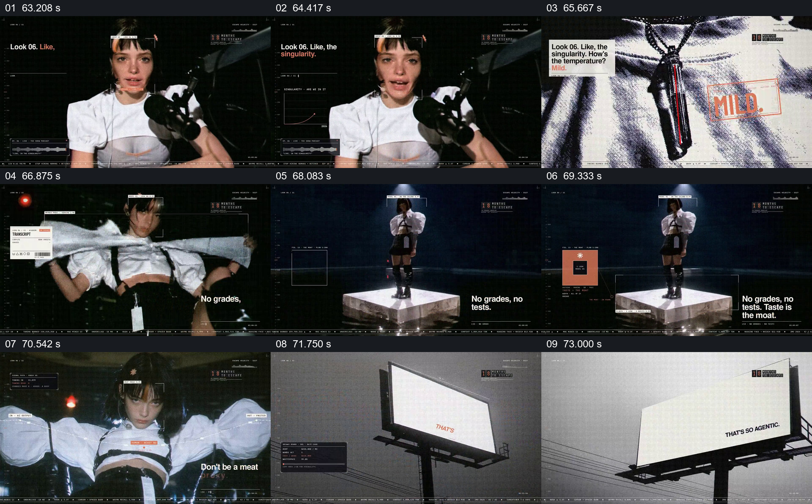

# 让一段评价经过人物、物件和广告牌三次显形

- 作品：案例 004《人物影像、服饰与图形标注》，为原库索引名称。
- 原片范围：01:03.000–01:14.000，含起点、不含终点；[完整原片](../video.mp4)｜[本卡片段](c12.mp4)。
- 范围依据：人物与麦克风建立，经过衣服细节、台上人物及广告牌，广告牌文字完整后结束。 范围与已有创意切片一致，复用既有切片和分镜。
- 观察方式与未确认范围：查看原片 64 帧总览和本卡九宫格；对原先未建卡的 74–98、164–184、250–275 秒补看逐秒源帧。未独立连续原速观看或听审，抽帧间动作、准确速度和声音配合仍待复核。画面中的数字、判断和界面均是作品呈现，设计价值为分析而非作者自述。

## 原画面具体怎样设计

人物正面对着右侧麦克风，脸和上身占据画面中心；左侧“Look 06”与逐步增加的短句并列，底部有小型波形样式界面。接着出现衣服拉链与温度样式特写，文字转为“MILD”；再回到人物张开双臂、手边白色长条和衣服标签。

观察距离拉到远处，人物独自站在深色空间里的一块明亮方形台座上；“No grades, no tests”在右下方，旁边的示意卡与线条把台座纳入画面。之后人物再次近景，画面转到户外广告牌；白色牌面从简短文字发展成“THAT'S SO AGENTIC.”，形成与人物段不同的最终载体。

## 为什么这样设计，好在哪里

相同观点从人物口边进入服饰细节，再被放到独立台座与户外牌面，观看位置从私人近距离扩大到公共空间。台座周围的暗色留白让身体和文字同时可辨，广告牌则把一句评价变成场景中真实可见的物件。

这是一种对画面组织的分析，不能仅凭嘴型或波形图断言实际语音和音乐节奏。

## 可直接使用的创意指令

当人物观点适合被多个载体递进呈现时，先以人物与其使用的物件建立具体发言场景，随后挑选与观点有关的物件细节，让它承担关键词，而不是重复一整段字幕。再用更远的场景或公共物件呈现经过压缩的一句结论，使观众从个人位置转到更大的语境。

主体身份、台座、广告牌和材质都可替换；要保留同一观点在各载体之间的可辨认联系，且所引述的真实发言需准确。

新题材中的迁移效果尚未实测。
