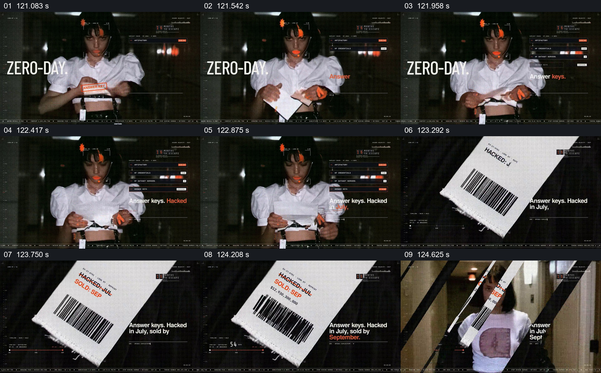

# 把被撕开的答案纸接成一张条码票据

- 作品：案例 004《人物影像、服饰与图形标注》（索引名称）。
- 原片范围：02:01.000–02:05.000，含起点、不含终点；[完整原片](../video.mp4)｜[本卡片段](c13.mp4)。
- 观察方式：按整片 64 宫格及每秒一次真实源帧复核，抽看本段九个源帧；未连续原速观看或听审，快速切换和声音保持未知。

## 原画面具体怎样设计

深色空间中人物低头拿着标有“ANSWER KEYS”的纸条，手部位置变化，纸条在抽帧中被拉开；旁边有“ZERO-DAY”和小型状态框。随后切到白色条码票据特写，票面出现“HACKED JUL / SOLD SEP”等字样。

## 为什么这样设计，好在哪里

先给手部动作，再给票据更大的阅读尺度，使文字符号既是人物接触的实体，也成为独立焦点。被撕开的纸条和票据是否为同一实体不能仅凭抽帧确认；日期和说法只是影片设计。

以上为依据画面的分析，非作者自述；预期观看效果未经观众测试。

## 可直接使用的创意指令

当一项关键信息要从人物动作转到文件特写时，选择与情境有关且可合法使用的纸条或票据，先让观众看到人物如何持有或处理它，再切到足以阅读的相关信息，并保留能识别关联的文字或形状。若素材之间并非同一实体，应如实说明；涉及事实的日期和交易需另有来源。
