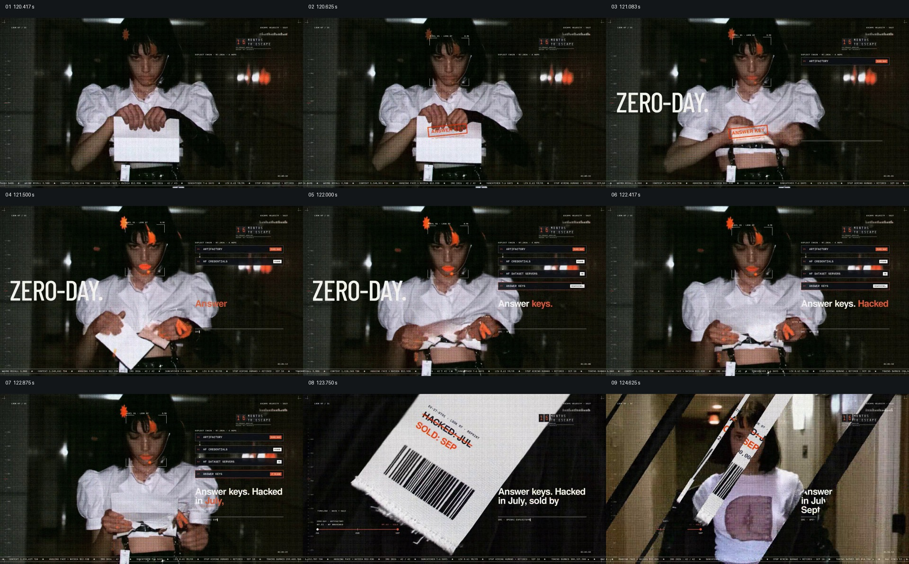

# 把撕开的纸条接成一张带时间信息的票据

- 作品：案例 004《人物影像、服饰与图形标注》，为原库索引名称。
- 原片范围：02:00.417–02:05.000，含起点、不含终点；[完整原片](../video.mp4)｜[本卡片段](c13-20261111.mp4)。
- 范围依据：从约 120.417 秒人物开始拿住完整白纸，到吊牌出现并显示前后状态；随后进入下一造型。 新范围从完整原片生成新切片和分镜。
- 观察方式与未确认范围：查看原片 64 帧总览和本卡九宫格；对原先未建卡的 74–98、164–184、250–275 秒补看逐秒源帧。另对 120–121 秒按 0.125 秒及临界帧加密。未独立连续原速观看或听审，抽帧间动作、准确速度和声音配合仍待复核。画面中的数字、判断和界面均是作品呈现，设计价值为分析而非作者自述。

## 原画面具体怎样设计

深色环境中人物正面持白纸，左侧大字“ZERO-DAY”，右侧有多行状态列表；手在胸前把纸撕开，文字逐步出现“Answer keys”。纸张的白色占据身体前方，列表与人物脸和手同时可见。

接下来镜头交给带条形码的白色布质标签特写，标签上可见“HACKED: JUL”和“SOLD: SEP”等字样，底部还有连接两个时间点的短线。人物从画面中心退到背景，吊牌成为阅读中心，结尾经斜条图形接入下一场。

## 为什么这样设计，好在哪里

人物实际接触纸张，随后由纸面近景承接状态与时间，画内信息不只是漂浮在旁边的解释。标签的材质和条形码也延续全片服装目录语汇，使技术事件被转写为可触摸的商品标签。

原片画面声称的事件、月份及金额没有独立核实；不同镜头之间是否为同一张实体纸条不能仅凭抽帧确定。

## 完整照排指令

以[完整原片](../video.mp4)的 120.417–125 秒为准。画幅 1280×720，源帧率 24/1。以下拍点为抽帧定位，位置按画幅百分比取近似值。

### 用料

- 【抓纸表演】【撕纸表演】【票据近景】用同一白纸或可对齐的纸形。抓纸和撕纸优先同一镜头，人物服装、左右手的施力方向和断口要接得上。近景需实际看清纸面与码区。
- 【事件标题】【时间句】【票据标题】【票据时间】【票据码】【邻段标题】按真实素材或剧情设定填写。【时间句】与【票据时间】来自同一份时间记录。声称真实披露或其他具体日期时附可打开的出处、记录日期及定位。

### 按源时刻摆放

1. **120.417–约 121.400 秒。** 同一人物的【抓纸表演】置中，白袖和白纸亮，背景为近黑通道，细短光点留在后方。纸在胸腹中下部，两手握上沿或两角。画面左中叠白色窄体粗【事件标题】，人物头部出现少量橙色追踪印，右上用几行短白橙读数留空在侧。
2. **约 121.400–123.400 秒。** 让【撕纸表演】延续施力，纸被拉开并转斜，保留手、裂口和纸面同时可见。右侧先显一行白色【时间句】，再补第二行，重要时间转橙。右侧字跟随讲述累积，纸上的印字随纸摆动。画面工具不能用定格、照片运镜或循环补齐撕裂。
3. **约 123.400–124.400 秒。** 切斜放的【票据近景】，奶白纸从左下至右上占主画幅，保留斜边和印有内容的中段。近中央以上分行用粗黑【票据标题】及橙色【票据时间】，下半留紧密黑条【票据码】。继续在右侧暗区显示【时间句】，避免把条码当画面叠加。近景只读票可用静态拍摄和轻微运镜，票上图文必须同层。
4. **约 124.400–125.000 秒。** 硬切暖灰室内的同一人物，白衣换有色胸口图案，左上小白【邻段标题】建立，右侧暗框露出。125.000 秒切出。若下一段不采用，结束在票据近景最后画面。

### 局部采用

只有可读票据与来源时，可截取约 123.400–124.400 秒单独作证据特写。没有对应撕纸动作时，不能采用从抓纸到票据的整段。

### 验证状态

已对照原片逐秒画序并读回，核对人物起手、撕开后右侧句子、斜票内黑码与右侧字幕的双层关系。精确断裂帧、原速听看及换料试摆待核。
