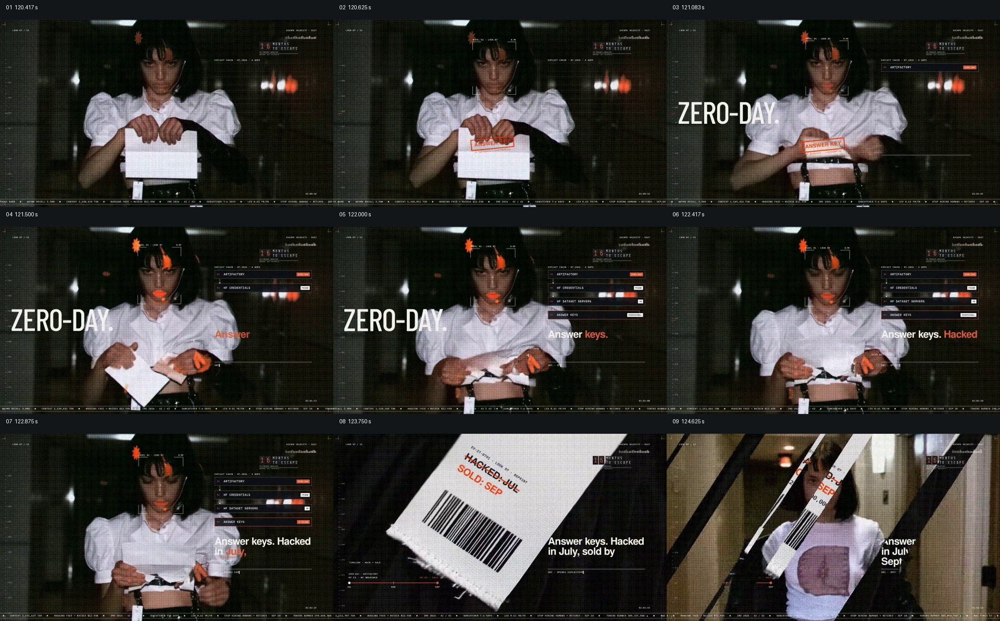

# 把撕开的纸条接成一张带时间信息的票据

- 作品：案例 004《人物影像、服饰与图形标注》，为原库索引名称。
- 原片范围：02:00.417–02:05.000，含起点、不含终点；[完整原片](../video.mp4)｜[本卡片段](c13-20261111.mp4)。
- 范围依据：从约 120.417 秒人物开始拿住完整白纸，到吊牌出现并显示前后状态；随后进入下一造型。 新范围从完整原片生成新切片和分镜。
- 观察方式与未确认范围：查看原片 64 帧总览和本卡九宫格；对原先未建卡的 74–98、164–184、250–275 秒补看逐秒源帧。另对 120–121 秒按 0.125 秒及临界帧加密。未独立连续原速观看或听审，抽帧间动作、准确速度和声音配合仍待复核。画面中的数字、判断和界面均是作品呈现，设计价值为分析而非作者自述。

## 原画面具体怎样设计

深色环境中人物正面持白纸，左侧大字“ZERO-DAY”，右侧有多行状态列表；手在胸前把纸撕开，文字逐步出现“Answer keys”。纸张的白色占据身体前方，列表与人物脸和手同时可见。

接下来镜头交给带条形码的白色布质标签特写，标签上可见“HACKED: JUL”和“SOLD: SEP”等字样，底部还有连接两个时间点的短线。人物从画面中心退到背景，吊牌成为阅读中心，结尾经斜条图形接入下一场。

## 为什么这样设计，好在哪里

人物实际接触纸张，随后由纸面近景承接状态与时间，画内信息不只是漂浮在旁边的解释。标签的材质和条形码也延续全片服装目录语汇，使技术事件被转写为可触摸的商品标签。

原片画面声称的事件、月份及金额没有独立核实；不同镜头之间是否为同一张实体纸条不能仅凭抽帧确定。

## 可直接使用的创意指令

把一个有明确前后状态的事件转化为物件表现时，先让人物拿取、翻开或处理一张具有可辨识形状的纸面材料，再切到能读清文字的票据或标签，把状态和必要时间关系放在该载体中。保留人物动作与阅读载体的视觉关联，并为结果留出可辨认的中途。

纸、布标签、票据外观和切换方式可随素材改变；用于真实事件时必须核实时间和来源，不把剪辑接续写成真实的因果或实体连续性。

新题材中的迁移效果尚未实测。
