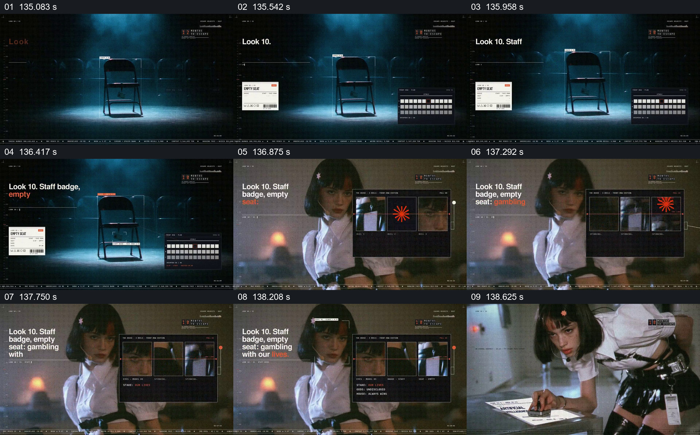

# 先给空座位，再把缺席接到人物与赌局面板

- 作品：案例 004《人物影像、服饰与图形标注》，为原库索引名称。
- 原片范围：02:15.000–02:19.000，含起点、不含终点；[完整原片](../video.mp4)｜[本卡片段](c14.mp4)。
- 范围依据：空椅、座位标记及人物旁的赌局界面完成一组隐喻，139 秒开始另一项词语改名。 范围与已有创意切片一致，复用既有切片和分镜。
- 观察方式与未确认范围：查看原片 64 帧总览和本卡九宫格；对原先未建卡的 74–98、164–184、250–275 秒补看逐秒源帧。未独立连续原速观看或听审，抽帧间动作、准确速度和声音配合仍待复核。画面中的数字、判断和界面均是作品呈现，设计价值为分析而非作者自述。

## 原画面具体怎样设计

深蓝黑背景中，一把空折叠椅位于光圈中央，后方还能看到暗下来的其他椅子。左侧逐渐出现“Look 10. Staff badge, empty seat”，一张商品样式标签位于左下，右下的座位图用小方格标出位置；因此空着的那一把椅子获得明确身份。

之后同一人物近景出现在左侧，右侧叠出带三个窗口的模拟转盘；窗内有眼睛、徽牌、座位等图像和红色标记，旁侧文字延长为“gambling with our lives”。末尾切到人物俯身及下一句“NOT AI”。

## 为什么这样设计，好在哪里

本段先让空缺作为能被看到的椅子存在，再用座位图指明它属于什么系统；人物出现后，转盘把“缺席”进一步联想到不确定的结果。椅子不是背景装饰，而是后面观点的空间起点。

转盘与风险文字构成片中的隐喻，不表示经过量化的现实风险。

## 完整照排指令

以[完整原片](../video.mp4)的 135–139 秒为准。画幅 1280×720，源帧率 24/1。以下拍点为抽帧定位，位置按画幅百分比取近似值。

### 用料

- 【空椅入口】为无人物的黑色椅子，置于蓝色窄顶光，椅脚与地面受光都能辨认。【佩证人物】为本系列同一人物白衣黑背带造型，要有胸前可读证牌与微小动作。【邻拍伏桌】留人物倾身桌前，供最后切出。
- 【空座标题】【缺席短句】【座位票字段】【座位矩阵】【赌局窗口】【赌局字段】【邻拍大字】共享同一缺席和赌局设定。赌局窗口需有数个小图预览区，图像与记录若指涉同一事件，应来自其不同视角或状态。虚构游戏面板标为剧情。声称真实事件时提供可打开的记录、日期及口径。

### 按源时刻摆放

1. **135.000–约 136.600 秒。** 【空椅入口】延续上卡。椅居中偏右一点，轮廓宽约画宽五分之一，座面在下半部。黑底中有冷蓝顶光与地面反亮，周围保持黑。左上小白【空座标题】，末词用橙，稍后补【缺席短句】。左下暖白票放【座位票字段】，右下薄暗板由两三行小亮矩形构成【座位矩阵】。椅为实景停留，可用静态，蓝色照度仍可轻变。
2. **约 136.600–138.600 秒。** 切【佩证人物】，大半身居中偏左，后方灰暖点光压低；左上白色两三行【缺席短句】扩写，重点词橙。右上至中部浮黑色【赌局窗口】，上半小窗并列，先有暗预览和红光状态，随后各小窗露出不同看点，下半灰橙小字排【赌局字段】。板压住白袖边缘并留开脸。相邻小窗若表达动态变化，从约 137 秒板出现持续到约 138.6 秒整板切走。可用真实连续裁段或按原有状态分层显隐，不循环至前一状态。人物仍继续微动。
3. **近 138.600–139.000 秒。** 【邻拍伏桌】硬切入，人物压在画面右上和中部，左侧背景落黑大字【邻拍大字】，桌面和手留在下部。以 139.000 秒切出。只采用空位与缺席的关系时，在伏桌首帧之前结束。

### 局部采用

只有空椅与座位信息，可用 135.000–约 136.600 秒，切到人物前结束。若只有人物与可信赌局面板，可用约 136.600–138.600 秒，须先在新片前文建立所指的缺席。

### 验证状态

已对照 1 帧/秒原片画序并读回，检查蓝色空椅先建立、人物画面保留左侧句子而右面转为多格暗板、伏桌切出。窗内更细状态、精确切点、听审与换料试摆待核。
