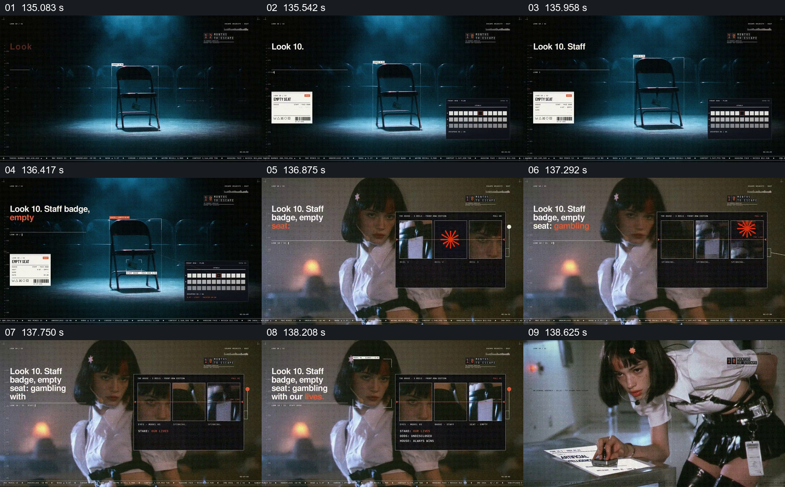

# 先展示空座，再把人物与多格界面并置

- 作品：案例 004《人物影像、服饰与图形标注》（索引名称）。
- 原片范围：02:15.000–02:19.000，含起点、不含终点；[完整原片](../video.mp4)｜[本卡片段](c14.mp4)。
- 观察方式：按整片 64 宫格及每秒一次真实源帧复核，抽看本段九个源帧；未连续原速观看或听审，快速切换和声音保持未知。

## 原画面具体怎样设计

蓝色暗场中一把空椅独自处于中央光圈，旁边出现“Look 10. Staff badge, empty seat”等说明及小型票据。随后换成人物近景，画面前方有三格深色界面，格内是人物画面与橙色符号。

## 为什么这样设计，好在哪里

空椅先建立明显的缺席，再通过标签与人物近景形成对照；三格界面让后续信息保持在同一画面中。空座所指的就业含义是片中的表达，不能由画面直接得出事实。

以上为依据画面的分析，非作者自述；预期观看效果未经观众测试。

## 可直接使用的创意指令

当要围绕一个缺席或空位建立人物处境时，先把椅子、工位或其他有语境的空物件放在清楚的位置，并给出其身份；随后引入关联人物和少量能解释关系的界面或文件，让物件的缺席与人物并列。真实人员变化应有来源，不能用空椅暗示未经证实的裁员。
