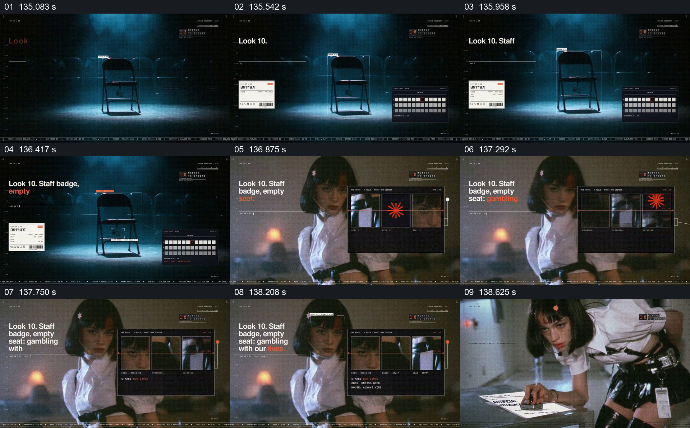

# 先给空座位，再把缺席接到人物与赌局面板

- 作品：案例 004《人物影像、服饰与图形标注》，为原库索引名称。
- 原片范围：02:15.000–02:19.000，含起点、不含终点；[完整原片](../video.mp4)｜[本卡片段](c14.mp4)。
- 范围依据：空椅、座位标记及人物旁的赌局界面完成一组隐喻，139 秒开始另一项词语改名。 范围与已有创意切片一致，复用既有切片和分镜。
- 观察方式与未确认范围：查看原片 64 帧总览和本卡九宫格；对原先未建卡的 74–98、164–184、250–275 秒补看逐秒源帧。未独立连续原速观看或听审，抽帧间动作、准确速度和声音配合仍待复核。画面中的数字、判断和界面均是作品呈现，设计价值为分析而非作者自述。

## 原画面具体怎样设计

深蓝黑背景中，一把空折叠椅位于光圈中央，后方还能看到暗下来的其他椅子。左侧逐渐出现“Look 10. Staff badge, empty seat”，一张商品样式标签位于左下，右下的座位图用小方格标出位置；因此空着的那一把椅子获得明确身份。

之后同一人物近景出现在左侧，右侧叠出带三个窗口的模拟转盘；窗内有眼睛、徽牌、座位等图像和红色标记，旁侧文字延长为“gambling with our lives”。末尾切到人物俯身及下一句“NOT AI”。

## 为什么这样设计，好在哪里

本段先让空缺作为能被看到的椅子存在，再用座位图指明它属于什么系统；人物出现后，转盘把“缺席”进一步联想到不确定的结果。椅子不是背景装饰，而是后面观点的空间起点。

转盘与风险文字构成片中的隐喻，不表示经过量化的现实风险。

## 可直接使用的创意指令

当某种缺席本身需要被观众感受到时，选择与缺席对象有明确对应的实体位置，例如空座、未占用工位或未完成容器。先让位置独立可辨，再用简短标签交代其原本属于谁；随后引入受影响的人或另一可见系统，让观众理解缺席的后果或不确定性。

对象和图形形式可以重设，但保留“具体空缺—身份—与人的关系”。现实事件需有确切依据，不能仅凭空画面推断人员或原因。

新题材中的迁移效果尚未实测。
