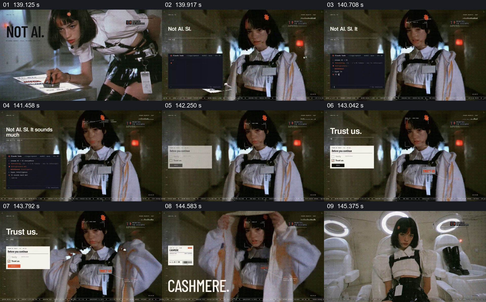

# 让改名提示、信任复选框与穿衣动作同场

- 作品：案例 004《人物影像、服饰与图形标注》，为原库索引名称。
- 原片范围：02:19.000–02:26.000，含起点、不含终点；[完整原片](../video.mp4)｜[本卡片段](c15.mp4)。
- 范围依据：从 NOT AI 字样建立，到人物穿衣和 CASHMERE 标签出现；之后进入稀缺座椅场面。 范围与已有创意切片一致，复用既有切片和分镜。
- 观察方式与未确认范围：查看原片 64 帧总览和本卡九宫格；对原先未建卡的 74–98、164–184、250–275 秒补看逐秒源帧。未独立连续原速观看或听审，抽帧间动作、准确速度和声音配合仍待复核。画面中的数字、判断和界面均是作品呈现，设计价值为分析而非作者自述。

## 原画面具体怎样设计

人物俯身在桌面前，左侧出现“NOT AI”；随后她站在走廊场景中，左侧短句改为“Not AI. SI.”，深色终端框中显示把 AI 改名为 SI 的命令。人物仍在右半画面，命令和短句则处于与脸部相邻的阅读位置。

终端位置随后被白色确认框接替，框中“Verify”旁显示不可用，“Trust us”被勾选；人物胸前的标牌也出现 TRUST US。人物抬手整理外层衣服，材质标签及大字“CASHMERE”出现，最后切到白色座椅场景。

## 为什么这样设计，好在哪里

名称变化和信任选项先后占据人物一侧的固定阅读位置，人物则持续作为视觉参照；观众可以把文本中的承诺与画面中的身体、服饰放到同一处境里。不可验证而要求信任的复选框，和前面的重新命名一起构成片中的讽刺，衣服标签则把表达重新接回服饰系列。

这只是对画面结构的分析，不代表画中命令真实执行，也不能从静态样帧确认手部动作与文字的精确同步。

## 可直接使用的创意指令

如果内容需要讨论名称、承诺和验证之间的差异，先确定一个可辨认的主体和一项具体主张，再让名称或承诺以可阅读的界面、标签或其他载体出现。保持主体作为参照，在同一视觉区域引入与该主张有关的验证条件或回应；随后让主体与实际物件发生可见关系，给观点一个具体落点。

人物、界面位置、服饰和文字可替换，必须保留声明、条件与主体之间的关系。涉及真实机构或系统时，验证状态和实际能力应有来源。

新题材中的迁移效果尚未实测。
