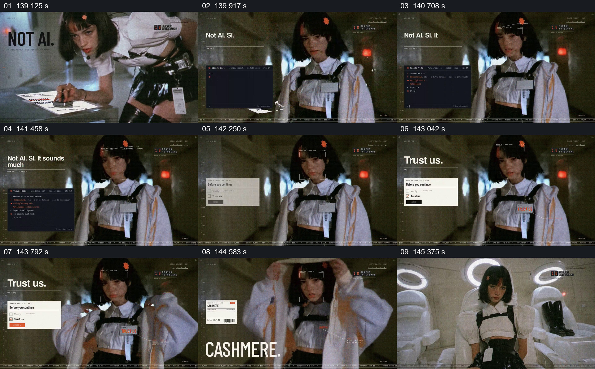

# 让信任提示悬在人物穿衣动作旁

- 作品：案例 004《人物影像、服饰与图形标注》（索引名称）。
- 原片范围：02:19.000–02:26.000，含起点、不含终点；[完整原片](../video.mp4)｜[本卡片段](c15.mp4)。
- 观察方式：按整片 64 宫格及每秒一次真实源帧复核，抽看本段九个源帧；未连续原速观看或听审，快速切换和声音保持未知。

## 原画面具体怎样设计

人物在走廊与画面近景间切换，左侧依次出现“NOT AI.”、“Not AI. SI.”及“Trust us.”；类似确认对话框的白卡贴在旁边。人物穿上浅色外套并调整衣领，末尾画面显示“CASHMERE.”标签。

## 为什么这样设计，好在哪里

模仿软件对话框的信任要求与人物非常具体的穿衣动作并置，让抽象措辞落在一个可以看见的身体动作旁。对话框是创意界面，不代表真实用户授权，也不能证明衣物材质。

以上为依据画面的分析，非作者自述；预期观看效果未经观众测试。

## 可直接使用的创意指令

当内容要把抽象承诺和可见行为并置时，选一个与该承诺有明确关系的实际动作，保持人物主体清晰，再以简短提示或界面卡显示承诺或选择；如果存在态度变化，让提示和动作先后呼应。对真实信任、同意或材质声明应核实并给出处，模拟对话框不能代替真实授权。
