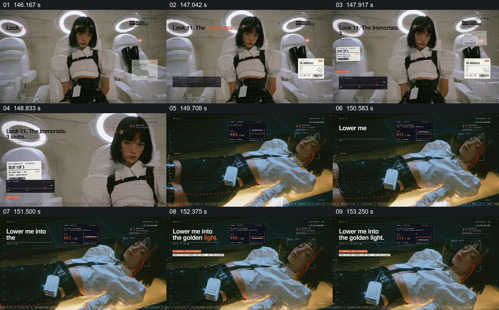

# 将稀缺座位和躺入金色光线连成一场

- 作品：案例 004《人物影像、服饰与图形标注》（索引名称）。
- 原片范围：02:26.000–02:34.000，含起点、不含终点；[完整原片](../video.mp4)｜[本卡片段](c16.mp4)。
- 观察方式：按整片 64 宫格及每秒一次真实源帧复核，抽看本段九个源帧；未连续原速观看或听审，快速切换和声音保持未知。

## 原画面具体怎样设计

白色室内有多个带圆环的座位，人物坐在前景；“The Immortals”“3 seats”等票据式标识分布在座椅旁。接着人物躺在一块金色发光区域上，身侧有曲线与小型监测样式框，短句逐步写出“Lower me into the golden light.”。

## 为什么这样设计，好在哪里

座椅与数量标签先建立稀缺的空间关系，随后以人物近景和金色光把注意从名额移到个人体验。数量、监测与永生均为画面中的虚构设计，不能作为现实事实。

以上为依据画面的分析，非作者自述；预期观看效果未经观众测试。

## 可直接使用的创意指令

当虚构内容从有限名额转入人物经历时，先用空间和清楚的数量标签建立谁可以进入，再跟随其中一位人物进入具体的光线或场所，保留能识别前后关联的服装或道具；用简短文字点出当下体验。真实名额与医疗、寿命等主张必须独立核实，不用装饰性监测界面作证据。
