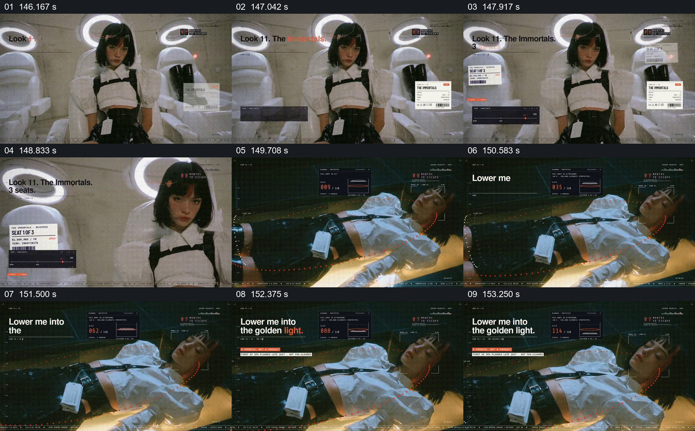

# 从稀缺座椅到金色扫描台，展示一项虚构承诺

- 作品：案例 004《人物影像、服饰与图形标注》，为原库索引名称。
- 原片范围：02:26.000–02:34.000，含起点、不含终点；[完整原片](../video.mp4)｜[本卡片段](c16.mp4)。
- 范围依据：从白色座椅与人物建立，到躺在金色光区及承诺说明显露；154 秒转入剩余月份。 范围与已有创意切片一致，复用既有切片和分镜。
- 观察方式与未确认范围：查看原片 64 帧总览和本卡九宫格；对原先未建卡的 74–98、164–184、250–275 秒补看逐秒源帧。未独立连续原速观看或听审，抽帧间动作、准确速度和声音配合仍待复核。画面中的数字、判断和界面均是作品呈现，设计价值为分析而非作者自述。

## 原画面具体怎样设计

浅色室内空间里有三张白色高背椅，人物位于中间座椅前，圆形顶灯与椅背形成一组重复形状；“Look 11. The Immortals”和座位卡、价格卡分布在人物周围。画内先给出三座位的集合，再突出其中的座位和期限文字。

随后改为人物平躺的斜向构图：身体横跨画面，底下是金色光区，红色点线沿身体外缘分布，上方的小面板呈现扫描示意和不断变化的编号。左侧短句组成“Lower me into the golden light”，旁边还标出“A PROMISE, NOT A PRODUCT”。人物与光区保持同一个主要构图，界面承担状态提示。

## 为什么这样设计，好在哪里

先看成组的座椅及稀缺标签，再看一个具体身体进入光区，抽象的“稀缺体验”被安排成从数量到个人处境的变化；扫描信息贴近身体，使所说的体验有可观察的空间对象。

“承诺而非产品”本身是片中可见限定。价格、医疗能力、扫描效果和人物感受都不能仅凭画面确认为事实。

## 完整照排指令

以[完整原片](../video.mp4)的 146–154 秒为准。画幅 1280×720，源帧率 24/1。以下拍点为抽帧定位，位置按画幅百分比取近似值。

### 用料

- 【座椅造型入口】沿用前卡同名项。座椅与发光圆环须有可见前后空间，人居中。备同一表演者的【金台卧姿】【牌前站姿】【瞳孔特写】，衣着、吊签与灯光走向保持可认。
- 【座位标题】【座位票一】【座位票二】【座位暗栏】【扫描短句】【扫描字段】【倒计数】【牌面承诺】【结果曲线】服务同一个虚构承诺。若呈现真实稀缺、时限或数据，需可打开的来源及计数口径，区分道具和证据。

### 按源时刻摆放

1. **146.000–约 148.500 秒。** 【座椅造型入口】铺满，浅灰或奶白装置占后景，圆环发白光，主角略偏右坐于中座。左上从短黑【座位标题】补成两行，右中先叠暖白【座位票一】，左中随后叠暖白【座位票二】，卡片内黑粗短标题压小密字段，左下另用横向暗【座位暗栏】。人物留在票间，装置不随界面移动。
2. **约 148.500–152.500 秒。** 硬切【金台卧姿】，头在右上、躯干沿斜金台向左下，暗青黑占上部，白衣受冷光，台沿下方亮金。细框及微弱点线沿身体布置，吊签贴实际胸腹位置。左上用白色小粗【扫描短句】逐行累加，中上偏右叠暗框【扫描字段】，左上字组下另进桔白细长状态条。卧姿画面露出后一路播放到切站姿；扫描标记追随人台的相对位置，扫描进程不循环。
3. **约 152.500–154.000 秒。** 换【牌前站姿】，人物居中，背后是大块深色格牌。左侧先读白色疏排【牌面承诺】和暖橙粗数字【倒计数】，右下白票载【结果曲线】。约 153.5 秒硬切【瞳孔特写】，用暖色侧光，极细框线让出眼睛，角落白小票保持。按 154.000 秒切出。站姿与眼部不得使用另一人的近景充数。

### 局部采用

只有充足的金台素材和扫描文案，可用约 148.500–152.500 秒，从卧姿出现到站姿前切。只有座椅则可用 146.000–约 148.500 秒，依据新片文案交代座位稀缺。

### 验证状态

已核对原片逐秒画序并读回。核对白环座椅与金台的色面突转、扫描文字在卧姿持续时增行、站姿数字和结果曲线先于瞳孔。精确切点、原速听看和换料试摆待核。
