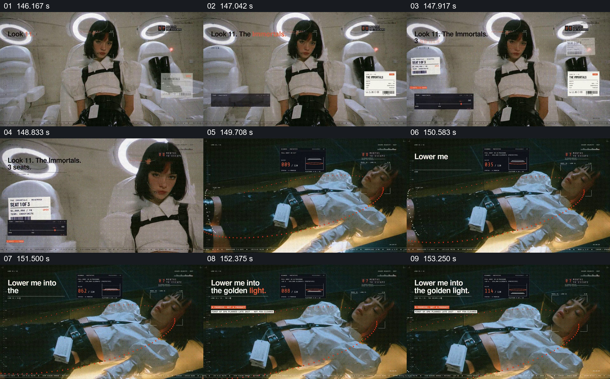

# 从稀缺座椅到金色扫描台，展示一项虚构承诺

- 作品：案例 004《人物影像、服饰与图形标注》，为原库索引名称。
- 原片范围：02:26.000–02:34.000，含起点、不含终点；[完整原片](../video.mp4)｜[本卡片段](c16.mp4)。
- 范围依据：从白色座椅与人物建立，到躺在金色光区及承诺说明显露；154 秒转入剩余月份。 范围与已有创意切片一致，复用既有切片和分镜。
- 观察方式与未确认范围：查看原片 64 帧总览和本卡九宫格；对原先未建卡的 74–98、164–184、250–275 秒补看逐秒源帧。未独立连续原速观看或听审，抽帧间动作、准确速度和声音配合仍待复核。画面中的数字、判断和界面均是作品呈现，设计价值为分析而非作者自述。

## 原画面具体怎样设计

浅色室内空间里有三张白色高背椅，人物位于中间座椅前，圆形顶灯与椅背形成一组重复形状；“Look 11. The Immortals”和座位卡、价格卡分布在人物周围。画内先给出三座位的集合，再突出其中的座位和期限文字。

随后改为人物平躺的斜向构图：身体横跨画面，底下是金色光区，红色点线沿身体外缘分布，上方的小面板呈现扫描示意和不断变化的编号。左侧短句组成“Lower me into the golden light”，旁边还标出“A PROMISE, NOT A PRODUCT”。人物与光区保持同一个主要构图，界面承担状态提示。

## 为什么这样设计，好在哪里

先看成组的座椅及稀缺标签，再看一个具体身体进入光区，抽象的“稀缺体验”被安排成从数量到个人处境的变化；扫描信息贴近身体，使所说的体验有可观察的空间对象。

“承诺而非产品”本身是片中可见限定。价格、医疗能力、扫描效果和人物感受都不能仅凭画面确认为事实。

## 可直接使用的创意指令

设计一个依赖空间和参与者的体验时，先展示可辨认的场所、可用位置或对象数量，再选定一个主体进入其中；把必要的条件文字放在主体附近，同时保留空间，让观众能理解身体与设备的关系。需要表现过程时，用与主体局部相连的标记或状态说明，最后清楚显示结果或限定条件。

位置数量、空间色彩和视觉材质可调整，但不能丢失整体场地、主体位置和条件说明之间的对应。涉及现实医疗或服务内容时，仅使用可核实的能力与条件。

新题材中的迁移效果尚未实测。
