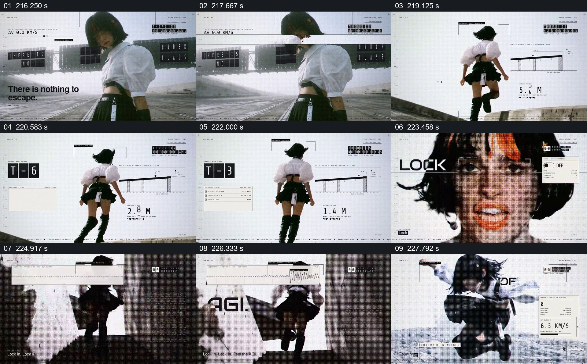

# 把距离、倒数与人物接近边缘放进同一空间

- 作品：案例 004《人物影像、服饰与图形标注》，为原库索引名称。
- 原片范围：03:36.000–03:49.000，含起点、不含终点；[完整原片](../video.mp4)｜[本卡片段](c17.mp4)。
- 范围依据：从上段结论的末尾接出人物，至跃起并出现新场景；不是只截取跳起瞬间。 范围与已有创意切片一致，复用既有切片和分镜。
- 观察方式与未确认范围：查看原片 64 帧总览和本卡九宫格；对原先未建卡的 74–98、164–184、250–275 秒补看逐秒源帧。未独立连续原速观看或听审，抽帧间动作、准确速度和声音配合仍待复核。画面中的数字、判断和界面均是作品呈现，设计价值为分析而非作者自述。

## 原画面具体怎样设计

人物近景位于道路与路牌前，画面留有“There is nothing to escape”及此前的标志性词组；随后转到人物背影，她面向画面深处的边缘。人物旁边出现侧视剖面样式的距离示意，数字从较远状态逐步减少。

左侧出现 T-6、T-3 等倒数小牌，右侧距离数值和示意图与人物位置同时可见；随后切到人物面部特写、“LOCK”与开关样式提示，再回到强对比的奔跑与跃起姿态。末尾人物悬在白色背景中，旁侧出现新的速度信息和标题，为下段接续。

## 为什么这样设计，好在哪里

距离示意并非独立于画面播放：它与人物背影、边缘位置并列，让抽象倒数对应到一个可见目标。临近目标时换成面部，再回到全身，使身体动作和心理处境各有阅读重点；最后的跃起画面为下一空间保留主体。

相邻源帧显示位置与数值的先后变化，但未连续听看，不能确认每次脚步、倒数和声音的同步点；速度数值也只是作品表现。

## 可直接使用的创意指令

当场景中的人物正在接近一个可明确识别的位置时，先建立人物、出发方向和目标之间的空间关系，再在画面空处放置与同一目标对应的距离、时间或阶段信息。让观众在主体仍可见时读到变化，接近关键动作时可切到人物局部，再回到全身显示动作结果与后续空间。

数值和示意必须与真实位置或明确的虚构设定一致；图形样式与摄像距离可调整，但要保留主体、目标和变化量之间的对应。

新题材中的迁移效果尚未实测。
