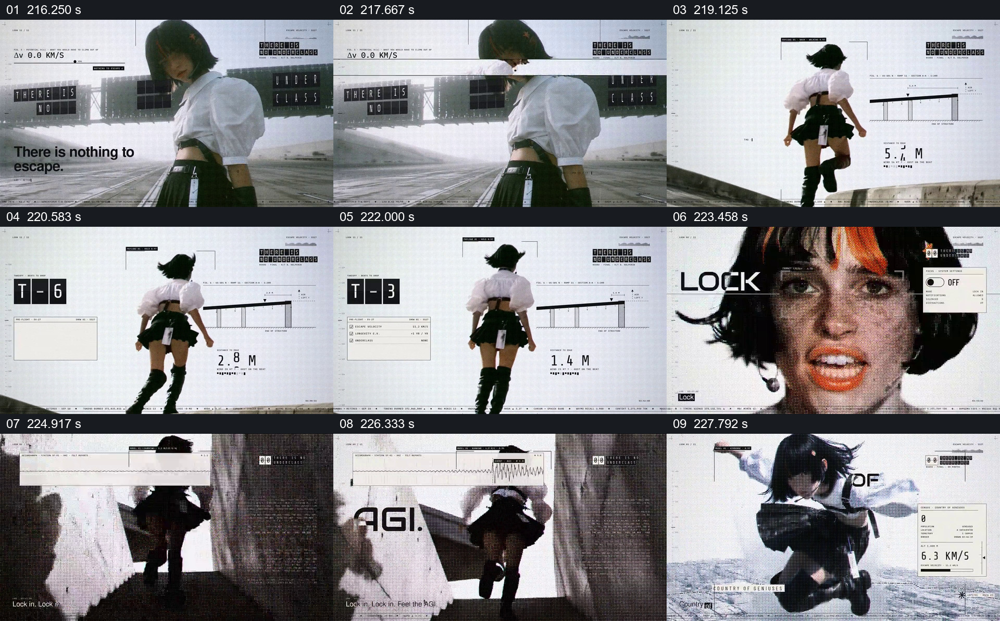

# 把奔跑距离与倒计时贴在人物行动旁

- 作品：案例 004《人物影像、服饰与图形标注》（索引名称）。
- 原片范围：03:36.000–03:49.000，含起点、不含终点；[完整原片](../video.mp4)｜[本卡片段](c17.mp4)。
- 观察方式：按整片 64 宫格及每秒一次真实源帧复核，抽看本段九个源帧；未连续原速观看或听审，快速切换和声音保持未知。

## 原画面具体怎样设计

白色空间中人物背向观众向前移动，旁边的线性图和距离文字从约 7.3 米减至更小数值，另一框出现“T-5”“T-3”。切到人物局部、奔跑和跃起姿态，旁边继续出现速度样式数值和短语。

## 为什么这样设计，好在哪里

距离和计时紧贴动作而不是单独占满画面，使抽象数字能够与人物逐渐靠近的过程联系起来。片中数值为图形装置，抽帧不足以确认每次移动的准确轨迹，也不能据此认为人物真的达到所标速度。

以上为依据画面的分析，非作者自述；预期观看效果未经观众测试。

## 可直接使用的创意指令

当人物动作与目标距离或剩余时间确有关系时，先建立人物与目标的位置，在不遮住动作的区域显示同一口径的距离或计时，让数值随可见过程变化；在关键到达或转折处保留可辨结果。真实测量须有可靠来源与单位，无法测量时明确使用示意，不用虚构速度制造事实。
