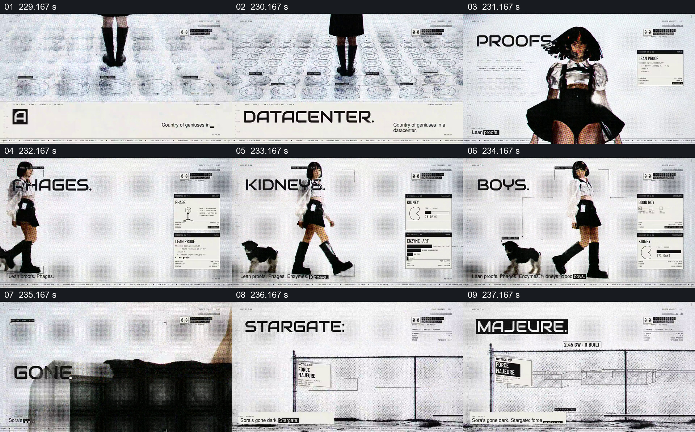

# 让人物走过一组名词，再将目光交给场所边界

- 作品：案例 004《人物影像、服饰与图形标注》，为原库索引名称。
- 原片范围：03:49.000–03:58.000，含起点、不含终点；[完整原片](../video.mp4)｜[本卡片段](c18.mp4)。
- 范围依据：从数据中心字样和人物脚下图形建立，至围栏与状态提示形成新画面；之后转入循环命令。 范围与已有创意切片一致，复用既有切片和分镜。
- 观察方式与未确认范围：查看原片 64 帧总览和本卡九宫格；对原先未建卡的 74–98、164–184、250–275 秒补看逐秒源帧。未独立连续原速观看或听审，抽帧间动作、准确速度和声音配合仍待复核。画面中的数字、判断和界面均是作品呈现，设计价值为分析而非作者自述。

## 原画面具体怎样设计

画面由人物脚部和一组重复圆形线图开始，白色底部写出 DATACENTER；接着人物以全身进入浅色空间，旁边依次出现 PROOFS、PHAGES、KIDNEYS 等大词，右侧小型卡片列出各词相关的示意或数值。

人物与一只黑色狗同时出现在画面中，人物从左侧到右侧的姿态在相邻源帧中变化，大字和说明卡随主题更换。随后主体让位于黑色物体近景，再接一段金属围栏，顶部大字由 STARGATE 转向 MAJEURE，围栏上挂有状态通知。场面从人的移动与词语转到一个具备边界的场所。

## 为什么这样设计，好在哪里

人物、狗和白色背景提供持续可识别的观看参照，变换的大词使各议题轮流取得注意；右侧小卡说明与名词相邻，避免所有信息同时争夺主要位置。最后让围栏占据画面，给这一连串名词一个具体的空间出口。

片中的科学、医学和项目进展说法未独立核实，词语的并置不能证明它们有因果关系；逐秒抽帧也不足以还原全部快切。

## 可直接使用的创意指令

当需要在同一段中展示若干彼此相关但不同的对象时，保留一个持续可辨认的主体或背景，让每个对象依次获得独立的名称和足以理解的材料；次要说明放在固定、可读的次级位置。展示结束后，选择与下一段真正相关的实物或场所作为接续，使文字集合落到具体空间。

名词数量、人物、说明卡和背景可改变；需要区分并列与因果，涉及真实成果、项目或医学数字时必须标明来源。

新题材中的迁移效果尚未实测。
