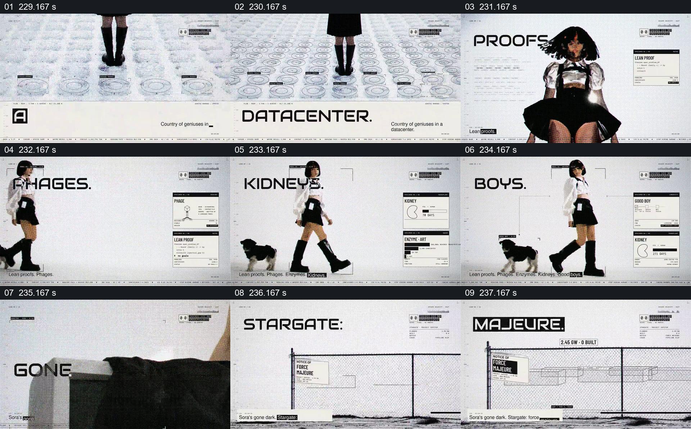

# 把人物动作与一串技术词条放在同一白色空间

- 作品：案例 004《人物影像、服饰与图形标注》（索引名称）。
- 原片范围：03:49.000–03:58.000，含起点、不含终点；[完整原片](../video.mp4)｜[本卡片段](c18.mp4)。
- 观察方式：按整片 64 宫格及每秒一次真实源帧复核，抽看本段九个源帧；未连续原速观看或听审，快速切换和声音保持未知。

## 原画面具体怎样设计

地面出现类似数据中心排列的圆形图样，人物进入白色空间；“PROOFS”“PHAGES”“ENZYMES”等大词依次换位，旁边配小型说明卡和图形。随后人物与小狗同框，画面转到围栏、设施线稿及状态文字。

## 为什么这样设计，好在哪里

相同白色场景与持续人物提供观看参照，大词和卡片分批出现，使不同概念被区分。快节奏更适合建立主题印象，片中图示不能验证这些领域的科学结论或设施状态。

以上为依据画面的分析，非作者自述；预期观看效果未经观众测试。

## 可直接使用的创意指令

当一段作品只需引出若干不同主题时，用一个持续的人物或空间维持连贯，为每个主题选择可核实的名称和一个有明确关系的图或物件，逐项显示并让主题之间边界清楚。需要解释原理时另给足阅读与证据，不把快速词条蒙太奇当作论证。
