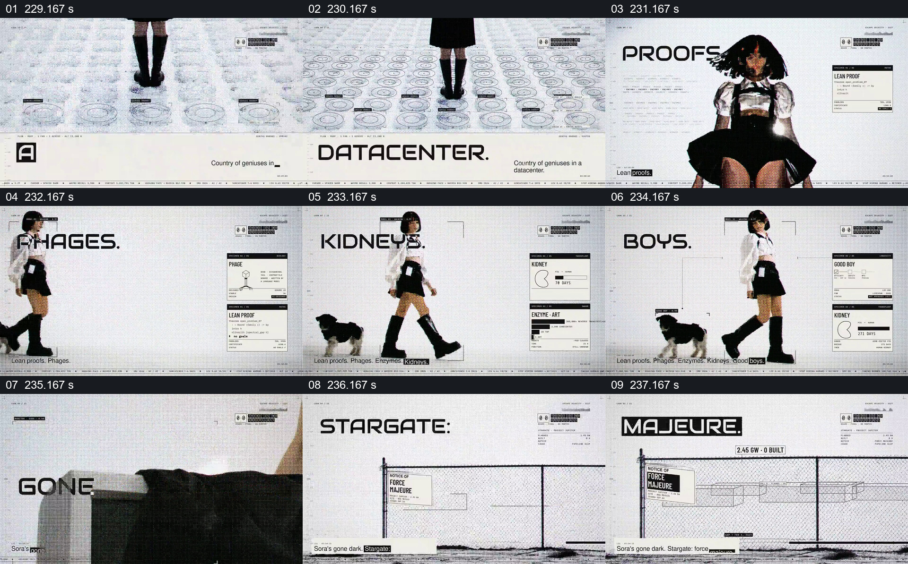

# 让人物走过一组名词，再将目光交给场所边界

- 作品：案例 004《人物影像、服饰与图形标注》，为原库索引名称。
- 原片范围：03:49.000–03:58.000，含起点、不含终点；[完整原片](../video.mp4)｜[本卡片段](c18.mp4)。
- 范围依据：从数据中心字样和人物脚下图形建立，至围栏与状态提示形成新画面；之后转入循环命令。 范围与已有创意切片一致，复用既有切片和分镜。
- 观察方式与未确认范围：查看原片 64 帧总览和本卡九宫格；对原先未建卡的 74–98、164–184、250–275 秒补看逐秒源帧。未独立连续原速观看或听审，抽帧间动作、准确速度和声音配合仍待复核。画面中的数字、判断和界面均是作品呈现，设计价值为分析而非作者自述。

## 原画面具体怎样设计

画面由人物脚部和一组重复圆形线图开始，白色底部写出 DATACENTER；接着人物以全身进入浅色空间，旁边依次出现 PROOFS、PHAGES、KIDNEYS 等大词，右侧小型卡片列出各词相关的示意或数值。

人物与一只黑色狗同时出现在画面中，人物从左侧到右侧的姿态在相邻源帧中变化，大字和说明卡随主题更换。随后主体让位于黑色物体近景，再接一段金属围栏，顶部大字由 STARGATE 转向 MAJEURE，围栏上挂有状态通知。场面从人的移动与词语转到一个具备边界的场所。

## 为什么这样设计，好在哪里

人物、狗和白色背景提供持续可识别的观看参照，变换的大词使各议题轮流取得注意；右侧小卡说明与名词相邻，避免所有信息同时争夺主要位置。最后让围栏占据画面，给这一连串名词一个具体的空间出口。

片中的科学、医学和项目进展说法未独立核实，词语的并置不能证明它们有因果关系；逐秒抽帧也不足以还原全部快切。

## 完整照排指令

以[完整原片](../video.mp4)的 229–238 秒为准。画幅 1280×720，源帧率 24/1。以下拍点为抽帧定位，位置按画幅百分比取近似值。

### 用料

- 【站姿足部】【服装正面】【横穿人物】【随行小动物】【垂眼近景】【空区镜头】【场所边界图】【下段动作】。人物使用同一服装和身份，横穿的人和动物优先用同期素材；分拍时须对齐落脚、地平线与移动方向。场所边界图需要真实测绘或明确剧情示意。
- 【惯用名词组】备多条可单独一屏的短名词，【右方资料票】按词条备局部小档案。【消失短句】【边界标题】【边界续句】【量测注记】关联合适地点。涉及实物身份、地点或尺寸时附可核对出处和单位。

### 按源时刻摆放

1. **229.000–约 230.000 秒。** 以【站姿足部】接上一场，小腿居中落在白灰纹地上，底部奶白带以宽黑几何字分拍完成【惯用名词组】的开头。再立切浅底【服装正面】，黑裙形成居中大梯形，白袖和深发飞扬。左上换下一短词，右侧先开小浅票。
2. **约 230.000–234.000 秒。** 左上黑色大号【惯用名词组】逐屏替换，每屏约半秒至一秒，不排成名单。右侧【右方资料票】为等宽细字段和几何小图，随词条换。切【横穿人物】和【随行小动物】从左向右，保留白底水平地面；人物步态与动物有清楚的前后差，长跨步一直播放到本组最后名词。禁止反复循环同一步，词条更换不触发视频重起。
3. **约 234.000–235.500 秒。** 切【垂眼近景】，人物居中偏右，左侧词组继续变为【消失短句】开头。再切【空区镜头】，先有一块压住白底的深色近物，然后近全黑，白色宽体短词收句。
4. **约 235.500–238.000 秒。** 黑场让给高亮【场所边界图】，左上粗黑【边界标题】与【边界续句】逐段替换，横直线图跨画宽，中段细小【量测注记】贴近相关线端。尾部硬切【下段动作】，人物斜身在浅灰地面，右边仍有淡线图，按 238.000 秒切出。静态图可逐层显出，不把场所尺寸用作人物位置的虚假证据。

### 局部采用

词和图齐全时可使用约 230–234 秒横穿拍。边界图与真实或剧情注释齐全时，可独立采用约 235.500–238.000 秒。只有单个名词时不保留整串快切。

### 验证状态

已对照每秒两帧原片画序并读回，检查横穿途中名词换页、压黑后边界图重新变亮，以及尾部斜身切出。精确切点、原速听看与换料待核。
