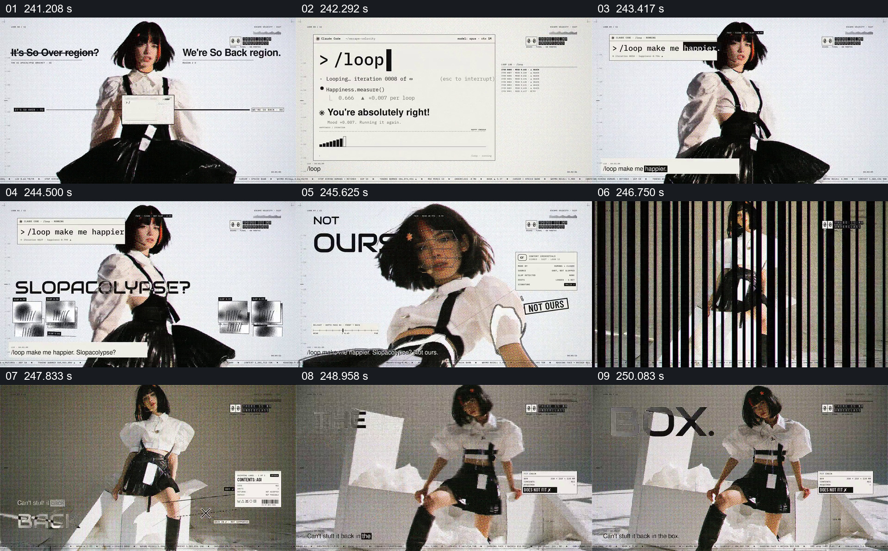

# 把循环命令、归属声明与装不回的盒子接成一段

- 作品：案例 004《人物影像、服饰与图形标注》，为原库索引名称。
- 原片范围：04:01.000–04:11.000，含起点、不含终点；[完整原片](../video.mp4)｜[本卡片段](c19.mp4)。
- 范围依据：从相反判断后的终端命令开始，至人物与盒子形成结果；之后回到全片反复出现的口号。 范围与已有创意切片一致，复用既有切片和分镜。
- 观察方式与未确认范围：查看原片 64 帧总览和本卡九宫格；对原先未建卡的 74–98、164–184、250–275 秒补看逐秒源帧。未独立连续原速观看或听审，抽帧间动作、准确速度和声音配合仍待复核。画面中的数字、判断和界面均是作品呈现，设计价值为分析而非作者自述。

## 原画面具体怎样设计

浅色背景中人物与两侧的相反区域文字同框，随后中央放大终端窗口，输入“/loop make me happier”，窗口内显示循环次数和条形指标。窗口缩到上方后，人物重新成为主要对象，命令仍停留在画面一角；下方出现 SLOPACOLYPSE 与一组小样图。

随后人物近景配“NOT OURS”字样和类似内容凭证的小卡，画面短暂被黑色竖条分隔；再切到人物坐在白色盒子和包装物中，后方巨字为 THE BOX，旁侧小卡写“DOES NOT FIT”。盒子和人物并置，形成该段最后的具体对象关系。

## 为什么这样设计，好在哪里

窗口里的循环先让抽象的重复行为有明确对象，人物重新出现时命令仍在一旁，观众能把人物与系统状态联系起来。归属声明之后，盒子提供一个物理上的结果画面；如果只保留终端和口号，就缺少“装不回去”这个可直接看到的比喻。

这些命令、情绪指标和归属凭证都属于作品中的示意；不能凭界面认定程序真实运行或内容来源已验证。

## 可直接使用的创意指令

当需要把抽象的重复或不可逆变化变成可观看的场面时，先选择一个清楚的重复指令、行为或状态，让观众能看到它在什么对象上发生；随后保留这一参照，引入被影响的人或物，并用一个真实可见的容器、边界或物件呈现结果。

终端、盒子、人物和文字形式可以更换，必须保留状态、受影响对象及物理结果之间的对应。对真实内容的权属与数据不能用模拟标记代替核实。

新题材中的迁移效果尚未实测。
